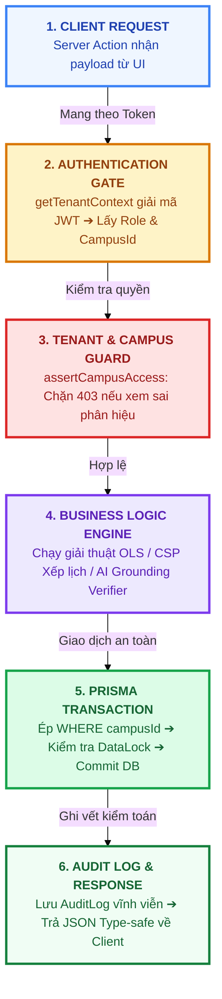
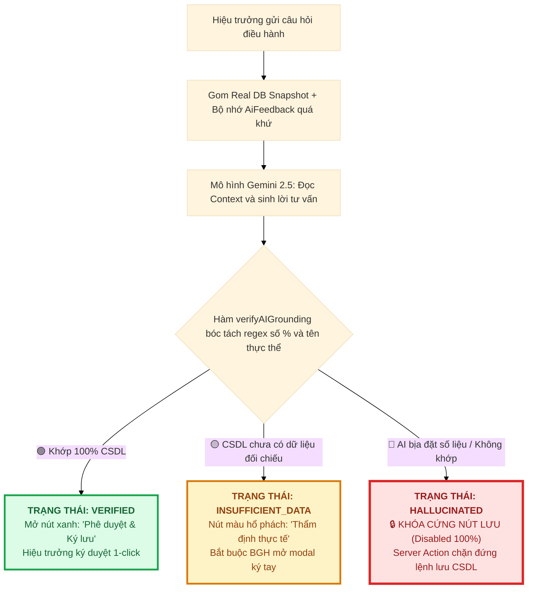

# 🏛️ BẢN 1: TÀI LIỆU ĐẶC TẢ LOGIC VẬN HÀNH & KIẾN TRÚC KỸ THUẬT HỆ THỐNG WEB
### Hệ Thống Quản Lý Trường Học Đa Cơ Sở & Trợ Lý Quản Trị Chiến Lược AI
* **Tác giả / Kỹ sư phát triển**: `phucbtfhn` (`phucbtfhn30307@gmail.com`)
* **Mã đề thi thực chứng**: `CMV8BKS3Q000101LYT7CKLC2C`
* **Kho mã nguồn GitHub**: [https://github.com/Phuc2009-c/quanlytruonghocc.git](https://github.com/Phuc2009-c/quanlytruonghocc.git)
* **Website chạy thực tế**: [https://quanlytruonghocc.vercel.app](https://quanlytruonghocc.vercel.app/login)
* **Cơ sở dữ liệu Đám mây**: Supabase PostgreSQL Cloud (Tokyo Region - `aws-0-ap-northeast-1`)
* **Kiểm định chất lượng**: **271/271 Unit Tests passed (100%)**, **0 Lỗi TypeScript**, **94 Routes biên dịch thành công**.

---

## 📌 MỤC LỤC BẢN 1
1. [Tổng Quan Kiến Trúc Phân Tầng Hệ Thống (System Layering)](#1-tổng-quan-kiến-trúc-phân-tầng-hệ-thống)
2. [Logic Vòng Đời Xử Lý Yêu Cầu Kỹ Thuật (Request-Response Lifecycle 6 Bước)](#2-logic-vòng-đời-xử-lý-yêu-cầu-kỹ-thuật)
3. [Logic Phân Quyền 8 Cấp & Cô Lập Đa Phân Hiệu (Tenant & Campus Scoping)](#3-logic-phân-quyền-8-cấp--cô-lập-đa-phân-hiệu)
4. [Logic Máy Trạng Thái Khóa Dữ Liệu 6 Cấp (Data Locking State Machine)](#4-logic-máy-trạng-thái-khóa-dữ-liệu-6-cấp)
5. [Logic Chốt Chặn Kiểm Định AI & Chống Ảo Giác (Decision Gate & Grounding)](#5-logic-chốt-chặn-kiểm-định-ai--chống-ảo-giác)
6. [Logic Toán Học Thực Chứng: Mô Hình Hồi Quy Tuyến Tính OLS](#6-logic-toán-học-thực-chứng-mô-hình-hồi-quy-tuyến-tính-ols)
7. [Logic Thuật Toán Điều Phối Dạy Thay Tối Ưu (CSP & Ma Trận Km Địa Lý)](#7-logic-thuật-toán-điều-phối-dạy-thay-tối-ưu)
8. [Đặc Tả Kỹ Thuật Logic Từng Vai Trò Tài Khoản (Inputs ➔ Processing ➔ Outputs)](#8-đặc-tả-kỹ-thuật-logic-từng-vai-trò-tài-khoản)

---

## 1. TỔNG QUAN KIẾN TRÚC PHÂN TẦNG HỆ THỐNG

Hệ thống được thiết kế theo mô hình **Kiến trúc Phân tầng Hướng Dịch vụ (Layered Clean Architecture)**, đảm bảo tính tách biệt trách nhiệm tuyệt đối (**Separation of Concerns**):

```
┌──────────────────────────────────────────────────────────────────────────────┐
│  TẦNG 1: GIAO DIỆN & TRẢI NGHIỆM NGƯỜI DÙNG (PRESENTATION LAYER)             │
│  • Next.js 16 App Router (94 Routes Type-Safe)                               │
│  • Server Components (SSR) kết hợp Client Components (PWA Offline-First)     │
└──────────────────────────────────────┬───────────────────────────────────────┘
                                       │ Server Actions (Zero REST API Boilerplate)
                                       ▼
┌──────────────────────────────────────────────────────────────────────────────┐
│  TẦNG 2: BẢO MẬT & PHÂN QUYỀN (SECURITY & ACCESS CONTROL GATE)               │
│  • NextAuth v4 với chuẩn JWT Token                                           │
│  • getTenantContext() trích xuất { userId, role, schoolId, campusId }        │
│  • assertCampusAccess() ném HTTP 403 nếu truy cập sai phân hiệu              │
│  • assertNotSuperAdminOnAcademicDetail() chặn xem điểm PII                   │
└──────────────────────────────────────┬───────────────────────────────────────┘
                                       │ Ngữ cảnh an toàn (TenantContext)
                                       ▼
┌──────────────────────────────────────────────────────────────────────────────┐
│  TẦNG 3: ĐỘNG CƠ XỬ LÝ NGHIỆP VỤ & TOÁN HỌC (CORE DOMAIN ENGINES)           │
│  • OLS Linear Regression Engine: Phân tích tiến trình học sinh (0.02ms)      │
│  • Constraint Satisfaction Dispatcher: Tối ưu dạy thay theo ma trận Km      │
│  • NQ37 & NĐ178 Engine: Định mức BGH dôi dư & bảo lưu phụ cấp 36 tháng      │
│  • Grounding Gate Verifier: Bóc tách regex, đo độ lệch số liệu chống ảo giác │
└──────────────────────────────────────┬───────────────────────────────────────┘
                                       │ Dữ liệu đã thẩm định
                                       ▼
┌──────────────────────────────────────────────────────────────────────────────┐
│  TẦNG 4: TRUY XUẤT DỮ LIỆU & KIỂM TOÁN (DATA PERSISTENCE & AUDIT)           │
│  • Prisma ORM v6.19.3 với mô hình Row-Level Security Scoping                 │
│  • Supabase PostgreSQL Cloud Tokyo (82 Bảng quan hệ chuẩn hóa)               │
│  • AuditLog ghi vết vĩnh viễn: User, IP, Timestamp, OldValue, NewValue      │
│  • DataLock Table: Đóng băng bất biến (Immutable State) khi đã duyệt         │
└──────────────────────────────────────────────────────────────────────────────┘
```

---

## 2. LOGIC VÒNG ĐỜI XỬ LÝ YÊU CẦU KỸ THUẬT

Mọi thao tác của người dùng trên web khi gửi lên máy chủ đều phải trải qua **Pipeline 6 bước tuần tự**:

```
┌──────────────────────────────────────────────────────────────────────────────┐
│  🖥️ BƯỚC 1: CLIENT GỬI REQUEST (CALL SERVER ACTION)                           │
│  Tài khoản thực hiện thao tác (Nhập điểm, Báo nghỉ, Yêu cầu AI tư vấn...)    │
└──────────────────────────────────────┬───────────────────────────────────────┘
                                       │ Kèm Cookie JWT Session
                                       ▼
┌──────────────────────────────────────────────────────────────────────────────┐
│  🔑 BƯỚC 2: AUTHENTICATION GATE (XÁC THỰC DANH TÍNH)                         │
│  • Hàm getTenantContext() giải mã Token JWT                                  │
│  • Trích xuất: userId, role, schoolId, campusId, isApproved                  │
│  • Nếu chưa đăng nhập / Token hết hạn ➔ Ném lỗi 401 Unauthorized             │
└──────────────────────────────────────┬───────────────────────────────────────┘
                                       │ Session hợp lệ
                                       ▼
┌──────────────────────────────────────────────────────────────────────────────┐
│  🛡️ BƯỚC 3: SECURITY & CAMPUS SCOPING GATE (CÔ LẬP KHÔNG GIAN DỮ LIỆU)       │
│  • isApproved === false ➔ Ép schoolId: "unapproved-no-access-000" (DB rỗng)  │
│  • VICE_PRINCIPAL ➔ Kiểm tra: targetCampusId === session.campusId             │
│    (Nếu cố tình truy cập điểm trường khác ➔ Ném lỗi HTTP 403 Forbidden)     │
│  • SUPER_ADMIN ➔ Chặn xem điểm số PII (assertNotSuperAdmin ➔ Lỗi 403)        │
└──────────────────────────────────────┬───────────────────────────────────────┘
                                       │ Hợp lệ quyền hạn
                                       ▼
┌──────────────────────────────────────────────────────────────────────────────┐
│  ⚙️ BƯỚC 4: BUSINESS & AI LOGIC ENGINE (THỰC THI THUẬT TOÁN)                 │
│  • Phân tích học sinh: Chạy thuật toán Hồi quy OLS trên CPU trong 0.02ms     │
│  • Điều phối dạy thay: Chạy thuật toán Quy hoạch ràng buộc CSP & Ma trận Km  │
│  • Tư vấn điều hành: Chạy LLM + verifyAIGrounding() đối soát số liệu CSDL    │
└──────────────────────────────────────┬───────────────────────────────────────┘
                                       │ Thực thi câu lệnh SQL
                                       ▼
┌──────────────────────────────────────────────────────────────────────────────┐
│  🗄️ BƯỚC 5: PRISMA TRANSACTION & IMMUTABILITY CHECK (GIAO DỊCH CSDL)         │
│  • Ép bộ lọc WHERE campusId / schoolId vào câu lệnh SQL                      │
│  • Kiểm tra trạng thái Khóa: Nếu bản ghi LOCKED ➔ Từ chối UPDATE / DELETE   │
│  • Commit an toàn xuống cơ sở dữ liệu Supabase PostgreSQL                    │
└──────────────────────────────────────┬───────────────────────────────────────┘
                                       │ Tự động ghi vết
                                       ▼
┌──────────────────────────────────────────────────────────────────────────────┐
│  📜 BƯỚC 6: AUDIT TRAIL & RESPONSE (GHI NHẬT KÝ & PHẢN HỒI CLIENT)           │
│  • Ghi vết vĩnh viễn vào bảng AuditLog: User, IP, Timestamp, Diff            │
│  • Trả kết quả JSON Type-safe về cho giao diện Client hiển thị               │
└──────────────────────────────────────────────────────────────────────────────┘
```



---

## 3. LOGIC PHÂN QUYỀN 8 CẤP & CÔ LẬP ĐA PHÂN HIỆU (CAMPUS SCOPING)

Hệ thống phân định rạch ròi phạm vi dữ liệu dựa trên tệp mã nguồn cốt lõi [src/lib/tenant.ts](file:///c:/Users/tungh/Desktop/quanlytruonghoc/src/lib/tenant.ts):

| Loại Tài Khoản | Phạm Vi CSDL (`ScopeType`) | Bộ Lọc SQL Bắt Buộc (`Prisma Where Clause`) | Cơ Chế Bảo Vệ / Mã Lỗi |
| :--- | :--- | :--- | :--- |
| **`SUPER_ADMIN`** | `GLOBAL` (Hạ tầng) | Chỉ đọc cấu hình máy chủ, sao lưu CSDL | **Chặn xem điểm/học bạ PII ➔ HTTP 403** (`assertNotSuperAdmin`) |
| **`DEPARTMENT_ADMIN`** | `DEPARTMENT` | `where: { school: { departmentId: ctx.departmentId } }` | Chỉ xem tổng hợp toàn tỉnh; không xem nội bộ lớp học |
| **`DISTRICT_ADMIN`** | `DISTRICT` | `where: { school: { districtWardId: ctx.districtWardId } }`| Chỉ xem các trường thuộc Phòng GD&ĐT |
| **`WARD_ADMIN`** | `WARD` (Địa lý) | `where: { campusId: { in: wardCampusIds } }` | Lọc các điểm lẻ trên địa bàn xã qua `CampusWardMap` |
| **`ADMIN` (Hiệu trưởng)** | `SCHOOL_GLOBAL` | `where: { schoolId: ctx.schoolId }` *(Không lọc campusId)* | Toàn quyền đọc/ghi cả 6 phân hiệu; ký duyệt AI; mở khóa sổ |
| **`VICE_PRINCIPAL`** | `CAMPUS_SCOPED` | `where: { campusId: ctx.campusId }` | **Khóa cứng theo điểm lẻ ➔ HTTP 403 nếu xem chéo** |
| **`SUBJECT_HEAD`** | `SUBJECT_GROUP` | `where: { subjectGroupId: { in: allowedIds } }` | Giới hạn theo môn phụ trách (`assertSubjectGroupAccess`) |
| **`TEACHER`** | `CLASS_OWNER` | `where: { classId: teacherClassId }` | Chỉ sửa được lớp mình dạy; bị tước quyền sửa khi `LOCKED` |
| **`STUDENT` / `PARENT`** | `INDIVIDUAL` | `where: { studentId: ctx.userId }` | Quyền Chỉ Đọc (Read-only); chỉ xem khi dữ liệu đã `LOCKED` |

---

## 4. LOGIC MÁY TRẠNG THÁI KHÓA DỮ LIỆU 6 CẤP (DATA LOCKING)

Toàn bộ dữ liệu điểm số và học bạ số bắt buộc phải dịch chuyển qua **Máy trạng thái 6 cấp (State Machine)** theo đúng quy chế sư phạm, triệt tiêu hoàn toàn khả năng tiêu cực sửa điểm:

```
┌──────────────────────────────────────────────────────────────────────────────┐
│  👨‍🏫 BƯỚC 1: DRAFT (BẢN NHÁP)                                                │
│  • Giáo viên bộ môn nhập điểm kiểm tra vào sổ điểm điện tử                  │
│  • Giáo viên còn toàn quyền chỉnh sửa trực tiếp                              │
└──────────────────────────────────────┬───────────────────────────────────────┘
                                       │ Giáo viên bấm "Nộp bảng điểm"
                                       ▼
┌──────────────────────────────────────────────────────────────────────────────┐
│  📨 BƯỚC 2: SUBMITTED (ĐÃ NỘP)                                               │
│  • Khóa quyền sửa trực tiếp của Giáo viên bộ môn                             │
│  • Chuyển hồ sơ lên Tổ chuyên môn thẩm định                                  │
└──────────────────────────────────────┬───────────────────────────────────────┘
                                       │ Tổ trưởng rà soát ma trận đề
                                       ▼
┌──────────────────────────────────────────────────────────────────────────────┐
│  🧑‍🏫 BƯỚC 3: CAMPUS_CONFIRMED (XÁC NHẬN CẤP TỔ)                              │
│  • Tổ trưởng chuyên môn ký xác nhận tính chuẩn mực đề thi                    │
│  • Hồ sơ chuyển lên Ban Giám hiệu phân hiệu cơ sở                            │
└──────────────────────────────────────┬───────────────────────────────────────┘
                                       │ Phó Hiệu trưởng kiểm tra phổ điểm
                                       ▼
┌──────────────────────────────────────────────────────────────────────────────┐
│  👔 BƯỚC 4: VP_REVIEWED (PHÂN HIỆU THẨM ĐỊNH)                                │
│  • Phó Hiệu trưởng phụ trách điểm trường ký duyệt cấp cơ sở                  │
│  • Trình hồ sơ lên Hiệu trưởng nhà trường                                    │
└──────────────────────────────────────┬───────────────────────────────────────┘
                                       │ Hiệu trưởng ký duyệt toàn trường
                                       ▼
┌──────────────────────────────────────────────────────────────────────────────┐
│  🎓 BƯỚC 5: PRINCIPAL_APPROVED (TOÀN TRƯỜNG PHÊ DUYỆT)                       │
│  • Hiệu trưởng ký số chính thức phê duyệt toàn trường                        │
│  • Kích hoạt hàm tự động lockDataRecord()                                    │
└──────────────────────────────────────┬───────────────────────────────────────┘
                                       │ ĐÓNG BĂNG VĨNH VIỄN CSDL
                                       ▼
┌──────────────────────────────────────────────────────────────────────────────┐
│  🔒 BƯỚC 6: LOCKED (ĐÓNG BĂNG BẤT BIẾN)                                      │
│  • CSDL từ chối 100% lệnh UPDATE hoặc DELETE (Immutable State)               │
│  • Mở cổng Sổ liên lạc điện tử cho Phụ huynh và Học sinh tra cứu             │
│  • Muốn sửa phải làm Phiếu giải trình Unlock Request có chữ ký Hiệu trưởng   │
└──────────────────────────────────────────────────────────────────────────────┘
```

* **Quy trình Mở khóa (Unlock Request Logic)**:
  1. Khi phát sinh đơn phúc khảo điểm, giáo viên tạo bản ghi `UnlockRequest` nêu rõ: Lý do, Biên bản phúc khảo, Danh sách học sinh cần sửa.
  2. Duy nhất tài khoản Hiệu trưởng (`ADMIN`) mới có quyền phê duyệt yêu cầu này.
  3. Khi duyệt, trạng thái tạm thời mở về `DRAFT` cho phép sửa.
  4. Mọi thông tin: *Ai mở khóa, Ai sửa, Giá trị điểm cũ, Giá trị điểm mới, IP, Timestamp* đều được ghi vết vĩnh viễn vào bảng `AuditLog`.

---

## 5. LOGIC CHỐT CHẶN KIỂM ĐỊNH AI & CHỐNG ẢO GIÁC (DECISION GATE)

Hệ thống áp dụng nguyên lý **Zero-Trust AI Output**. Văn bản do LLM sinh ra **chưa được phép coi là quyết định hành chính** mà phải bước qua chốt chặn tại [src/lib/ai/data-integrity.ts](file:///c:/Users/tungh/Desktop/quanlytruonghoc/src/lib/ai/data-integrity.ts):



* **Thuật toán Kiểm định Thực chứng**:
  - Quét văn bản AI trích xuất các con số phần trăm: `/(\d+(?:\.\d+)?)\s*%/g`.
  - Quét danh tính giáo viên, mã học sinh, mã điểm trường.
  - So sánh với bộ dữ liệu Ground Truth $\mathcal{G}$ từ PostgreSQL.
  - Nếu độ lệch $> 0.5\%$: Đánh cờ `HALLUCINATED`. Nút Save bị vô hiệu hóa cả ở Client lẫn tầng Server Action `saveDecision()`.

---

## 6. LOGIC TOÁN HỌC THỰC CHỨNG: MÔ HÌNH HỒI QUY TUYẾN TÍNH OLS

Triết lý sống còn: **Những gì thuộc về số học chính xác thì không giao cho LLM tính toán**. Hệ thống sử dụng thuật toán **Bình phương Tối thiểu (Ordinary Least Squares - OLS)** tại [src/lib/student-journey/regression.ts](file:///c:/Users/tungh/Desktop/quanlytruonghoc/src/lib/student-journey/regression.ts) chạy trong **0.02ms** trên CPU:

* **Công thức toán học**:
  Cho tập điểm học sinh qua $n$ kỳ đánh giá: $\{(x_1, y_1), (x_2, y_2), \dots, (x_n, y_n)\}$. Đường xu hướng $\hat{y} = ax + b$:
  $$a = \frac{n\sum_{i=1}^{n} (x_i y_i) - \left(\sum_{i=1}^{n} x_i\right)\left(\sum_{i=1}^{n} y_i\right)}{n\sum_{i=1}^{n} x_i^2 - \left(\sum_{i=1}^{n} x_i\right)^2}$$
  $$\text{Độ phân tán bất ổn (RMS)} = \sqrt{\frac{1}{n}\sum_{i=1}^{n} (y_i - \hat{y}_i)^2}$$

* **Ma trận Phân loại 4 Quỹ đạo Sư phạm**:
  1. **Tiến bộ (Improving)**: $a \ge +0.25$ và $\text{RMS} < 1.0$ (Điểm số đi lên đều đặn).
  2. **Sa sút / Nguy cơ (Declining)**: $a \le -0.25$ (Học lực suy giảm liên tục ➔ Kích hoạt cảnh báo sớm).
  3. **Biến động bất thường (Volatile)**: $\text{RMS} \ge 1.2$ (Dấu hiệu bất ổn tâm lý hoặc biến cố gia đình).
  4. **Ổn định (Stable)**: $|a| < 0.25$ và $\text{RMS} < 0.8$.

---

## 7. LOGIC THUẬT TOÁN ĐIỀU PHỐI DẠY THAY TỐI ƯU (CSP & KM ĐỊA LÝ)

Khi giáo viên tại điểm trường vùng cao báo vắng đột xuất (do đường đèo sạt lở hoặc ốm), hệ thống kích hoạt thuật toán **Thỏa mãn Ràng buộc (Constraint Satisfaction Problem - CSP)** tại [src/lib/smart-timetable-engine.ts](file:///c:/Users/tungh/Desktop/quanlytruonghoc/src/lib/smart-timetable-engine.ts):

* **Bộ Ràng buộc Cứng (Hard Constraints - Bắt buộc 100%)**:
  1. Giáo viên thay thế không có lịch dạy chính khóa vào tiết đó trong TKB.
  2. Đúng chuyên môn văn bằng môn học (Toán, Tiếng Việt, Tin học...).
  3. Không vượt quá định mức tiết tối đa/tuần theo Thông tư 28/2009/TT-BGDĐT.
* **Bộ Ràng buộc Mềm & Ma trận Địa lý Km (Soft Constraints)**:
  - Tối ưu hàm mục tiêu: $\min Z = \sum \text{Khoảng cách Km} + \text{Tránh điều chuyển chéo buổi}$.
  - Ma trận khoảng cách thực tế:
    - Trung tâm ➔ Sơn Hà 1: $3.5\text{ km}$
    - Trung tâm ➔ Sơn Hà 2: $5.2\text{ km}$
    - Trung tâm ➔ Sơn Hải: $6.8\text{ km}$
    - Trung tâm ➔ An Tiến: $8.5\text{ km}$ (đèo dốc hiểm trở)
  - Ưu tiên giáo viên đang có mặt tại chính phân hiệu ➔ Giáo viên tại điểm lân cận gần nhất.

---

## 8. ĐẶC TẢ KỸ THUẬT LOGIC TỪNG VAI TRÒ TÀI KHOẢN

```
┌────────────────────────────────────────────────────────────────────────────────────────────────────────┐
│                                 ĐẶC TẢ KỸ THUẬT TỪNG VAI TRÒ TÀI KHOẢN                                 │
├───────────────────┬─────────────────────────┬────────────────────────────┬─────────────────────────────┤
│ VAI TRÒ TÀI KHOẢN │ INPUTS (ĐẦU VÀO)        │ LOGIC XỬ LÝ (PROCESSING)   │ OUTPUTS (KẾT QUẢ ĐẦU RA)    │
├───────────────────┼─────────────────────────┼────────────────────────────┼─────────────────────────────┤
│ 1. TEACHER        │ Danh sách học sinh lớp, │ Offline Cache PWA, mã hóa  │ Bản ghi DRAFT, gửi nộp      │
│ (Giáo viên)       │ điểm kiểm tra thang 10  │ điểm, format TT 22/27      │ SUBMITTED, thông báo báo vắng│
├───────────────────┼─────────────────────────┼────────────────────────────┼─────────────────────────────┤
│ 2. SUBJECT_HEAD   │ Bảng điểm nộp của tổ,   │ assertSubjectGroupAccess,  │ Ký duyệt cấp tổ, chuyển     │
│ (Tổ trưởng)       │ ma trận đề thi          │ thẩm định phổ điểm         │ trạng thái CAMPUS_CONFIRMED │
├───────────────────┼─────────────────────────┼────────────────────────────┼─────────────────────────────┤
│ 3. VICE_PRINCIPAL │ Dữ liệu phân hiệu, cờ   │ assertCampusAccess(403),   │ Ký duyệt cơ sở VP_REVIEWED, │
│ (Phó Hiệu trưởng) │ cảnh báo chuyên cần     │ lọc vắng > 3 ngày          │ điều động giáo viên tại chỗ │
├───────────────────┼─────────────────────────┼────────────────────────────┼─────────────────────────────┤
│ 4. ADMIN          │ Snapshot 6 điểm trường, │ verifyAIGrounding, Decision│ Khóa sổ LOCKED, phê duyệt   │
│ (Hiệu trưởng)     │ câu hỏi chỉ đạo AI      │ Gate, lockDataRecord()     │ Unlock Request, AuditLog    │
├───────────────────┼─────────────────────────┼────────────────────────────┼─────────────────────────────┤
│ 5. ACCOUNTANT     │ Danh sách cán bộ dôi dư │ Tính chênh lệch phụ cấp,   │ Bảng dự toán chi ngân sách, │
│ (Kế toán nhân sự) │ sau sáp nhập trường     │ đếm ngược 36 tháng NĐ 178  │ phiếu chi trả Kho bạc       │
├───────────────────┼─────────────────────────┼────────────────────────────┼─────────────────────────────┤
│ 6. STUDENT/PARENT │ Mã định danh học sinh,  │ Chỉ đọc khi bản ghi LOCKED,│ Sổ liên lạc điện tử, đồ thị │
│ (Học sinh/PH)     │ tài khoản đăng nhập     │ lọc where studentId        │ tiến trình học tập OLS      │
├───────────────────┼─────────────────────────┼────────────────────────────┼─────────────────────────────┤
│ 7. GOV_ADMIN      │ Mã định danh tỉnh/huyện/│ Quyền Read-only vĩ mô,     │ Báo cáo thống kê phổ cập,   │
│ (Sở/Phòng/Xã)     │ xã phụ trách            │ CampusWardMap              │ thanh tra chất lượng đào tạo│
└───────────────────┴─────────────────────────┴────────────────────────────┴─────────────────────────────┘
```
