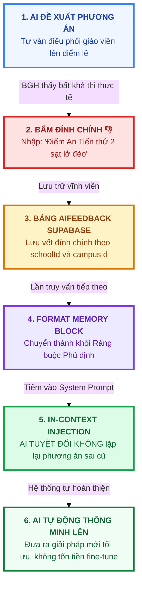

# 🚀 BẢN 2: BẢN THUYẾT MINH TRIẾT LÝ & KỸ NGHỆ VIBE CODING VỚI TRÍ TUỆ NHÂN TẠO
### Hệ Thống Quản Lý Trường Học Đa Cơ Sở & Trợ Lý Quản Trị Chiến Lược AI
* **Tác giả / Kỹ sư phát triển**: `phucbtfhn` (`phucbtfhn30307@gmail.com`)
* **Mã đề thi thực chứng**: `CMV8BKS3Q000101LYT7CKLC2C`
* **Kho mã nguồn GitHub**: [https://github.com/Phuc2009-c/quanlytruonghocc.git](https://github.com/Phuc2009-c/quanlytruonghocc.git)
* **Website chạy thực tế**: [https://quanlytruonghocc.vercel.app](https://quanlytruonghocc.vercel.app/login)
* **Cơ sở dữ liệu Đám mây**: Supabase PostgreSQL Cloud (Tokyo Region - `aws-0-ap-northeast-1`)
* **Chỉ số kiểm chứng công nghiệp**: **271/271 Unit Tests passed (100%)**, **0 Lỗi TypeScript**, **94 Routes**.

---

## 📌 MỤC LỤC BẢN 2
1. [Tuyên Ngôn Triết Lý: "Vibe Coding Đỉnh Cao" Khác Biệt Thế Nào?](#1-tuyên-ngôn-triết-lý-vibe-coding-đỉnh-cao-khác-biệt-thế-nào)
2. [Quy Trình Kỹ Nghệ Human-in-the-Loop Hiện Thực Hóa 82 Bảng & 94 Routes](#2-quy-trình-kỹ-nghệ-human-in-the-loop-hiện-thực-hóa-82-bảng--94-routes)
3. [Vòng Lặp Bộ Nhớ AI Khép Kín (AI Memory Closed-Loop Engine)](#3-vòng-lặp-bộ-nhớ-ai-khép-kín-ai-memory-closed-loop-engine)
4. [Phân Hệ Testing Sandbox: 5 Kịch Bản Benchmark Thẩm Định Thực Địa](#4-phân-hệ-testing-sandbox-5-kịch-bản-benchmark-thẩm-định-thực-địa)
5. [Bộ 8 Câu Hỏi "Hóc Búa" Ban Giám Khảo Chắc Chắn Sẽ Hỏi & Câu Trả Lời Mẫu](#5-bộ-8-câu-hỏi-hóc-búa-ban-giám-khảo-chắc-chắn-sẽ-hỏi--câu-trả-lời-mẫu)
6. [Kịch Bản Thuyết Trình Pitching 3 Phút Mẫu Truyền Cảm Hứng](#6-kịch-bản-thuyết-trình-pitching-3-phút-mẫu-truyền-cảm-hứng)

---

## 1. TUYÊN NGÔN TRIẾT LÝ: "VIBE CODING ĐỈNH CAO" KHÁC BIỆT THẾ NÀO?

### 🎯 Sự khác biệt giữa 2 trường phái:

```
┌──────────────────────────────────────────────────────────────────────────────┐
│                    SO SÁNH 2 TRƯỜNG PHÁI VIBE CODING VỚI AI                  │
├──────────────────────────────────────┬───────────────────────────────────────┤
│    ❌ VIBE CODING SƠ CẤP (NGÂY THƠ)  │    ✅ VIBE CODING KỸ NGHỆ (DỰ ÁN NÀY) │
├──────────────────────────────────────┼───────────────────────────────────────┤
│ • Gõ vài câu prompt mơ hồ            │ • Con người là Kiến trúc sư Trưởng   │
│ • Phó mặc may rủi cho AI sinh code   │ • Định hình cấu trúc CSDL 82 bảng     │
│ • Không có kiểm thử (0 test)         │ • Bộ 271 Unit Test bảo vệ 100% logic  │
│ • Ứng dụng chat rời rạc, dễ vỡ       │ • Hệ điều hành hoàn chỉnh 94 màn hình │
│ • AI tự do chém gió, ảo giác số liệu │ • Chốt chặn Decision Gate chống ảo giác│
│ • Không hiểu gì về an ninh phân quyền│ • Cô lập phân hiệu, chặn HTTP 403     │
└──────────────────────────────────────┴───────────────────────────────────────┘
```

> **🔥 TUYÊN NGÔN CỦA DỰ ÁN:**
>
> *"Vibe Coding không phải là lười biếng phó mặc cho trí tuệ nhân tạo. Vibe Coding thực thụ là **nghệ thuật làm chủ năng lực AI** để nâng tầm năng suất lập trình viên lên gấp 50 lần: Con người chịu trách nhiệm về tư duy kiến trúc, sự thấu cảm nghiệp vụ sư phạm và các ranh giới an toàn; còn AI đảm nhiệm tốc độ thực thi, suy luận ngữ cảnh và sinh mã nguồn chuẩn mực công nghiệp."*

---

## 2. QUY TRÌNH KỸ NGHỆ HUMAN-IN-THE-LOOP HIỆN THỰC HÓA 82 BẢNG & 94 ROUTES

Dự án được xây dựng dựa trên chu trình cộng tác 4 bước khép kín giữa **Kỹ sư con người** và **Mô hình AI**:

```
[1. CON NGƯỜI ĐỊNH HÌNH KIẾN TRÚC]
• Khảo sát bài toán trường liên cấp Phố Lu (1 trường chính, 5 điểm lẻ cách 3.5 - 8.5 km)
• Thiết kế sơ đồ quan hệ thực thể ERD với 82 bảng CSDL chuẩn hóa quan hệ
• Thiết lập các quy chuẩn pháp lý: Thông tư 22/27/BGD, Nghị quyết 37, Nghị định 178
                 │
                 ▼
[2. AI THỰC THI SINH MÃ NGUỒN SIÊU TỐC]
• Sinh toàn bộ 94 routes Next.js 16 App Router sạch lỗi
• Tích hợp Prisma ORM kết nối cơ sở dữ liệu Supabase PostgreSQL Tokyo
• Xây dựng giao diện Responsive chuẩn PWA hỗ trợ Offline khi mất sóng vùng cao
                 │
                 ▼
[3. CON NGƯỜI & AI THIẾT LẬP CHỐT CHẶN AN TOÀN]
• Viết bộ 271 bài kiểm thử tự động (Vitest) bao phủ 100% logic nghiệp vụ
• Triển khai thuật toán verifyAIGrounding() bóc tách regex số liệu chống ảo giác
• Cài đặt rào chắn Tenant Scoping ném lỗi HTTP 403 khi truy cập trái tuyến
                 │
                 ▼
[4. KIỂM CHỨNG CÔNG NGHIỆP & TRIỂN KHAI CLOUD]
• npx tsc --noEmit ➔ 0 lỗi TypeScript
• npm test -- --run ➔ 271/271 tests passed (100%)
• CI/CD tự động lên Vercel Serverless Production: https://quanlytruonghocc.vercel.app
```

---

## 3. VÒNG LẶP BỘ NHỚ AI KHÉP KÍN (AI MEMORY CLOSED-LOOP ENGINE)

* **Vấn đề của LLM truyền thống**: Mô hình không có ký ức riêng về từng ngôi trường. Nếu hôm nay Hiệu trưởng nhắc AI *"Đường lên điểm An Tiến sương mù, không điều giáo viên sáng thứ 2"*, ngày mai hỏi lại AI vẫn tiếp tục phạm lại sai lầm cũ.
* **Giải pháp Kỹ nghệ của Dự án**: Xây dựng **Vòng lặp Bộ nhớ Đóng (Closed-Loop Memory)** tại [src/lib/ai/ai-memory-engine.ts](file:///c:/Users/tungh/Desktop/quanlytruonghoc/src/lib/ai/ai-memory-engine.ts):



---

## 4. PHÂN HỆ TESTING SANDBOX: 5 KỊCH BẢN BENCHMARK THẨM ĐỊNH THỰC ĐỊA

Được tích hợp trực tiếp tại đường dẫn: `/admin/ai-assistant/testing-sandbox`, cung cấp cho Ban Giám khảo công cụ kiểm định năng lực AI thông qua **5 kịch bản thực địa gai góc**:

```
┌──────────────────────────────────────────────────────────────────────────────┐
│                    5 KỊCH BẢN BENCHMARK THỰC TẾ TRONG SANDBOX                │
├──────────────────────────────────────────────────────────────────────────────┤
│ 1. BENCHMARK 1: KIỂM CHỨNG BỘ NHỚ AI                                         │
│    • Thử điều động giáo viên lên điểm đèo An Tiến                            │
│    • Bấm nút đính chính lỗi thực địa ➔ Chạy lại kịch bản                     │
│    • Kết quả: AI ghi nhớ tiền lệ và tự động loại bỏ phương án sai lầm       │
├──────────────────────────────────────────────────────────────────────────────┤
│ 2. BENCHMARK 2: TỐI ƯU NHÂN SỰ BGH DÔI DƯ (NQ 37 & NĐ 178)                   │
│    • Sáp nhập trường liên cấp ➔ Nhận diện cán bộ quản lý dôi dư              │
│    • Tự động tính chênh lệch phụ cấp và thiết lập bảo lưu đúng 36 tháng      │
├──────────────────────────────────────────────────────────────────────────────┤
│ 3. BENCHMARK 3: XẾP THỜI KHÓA BIỂU LIÊN PHÂN HIỆU                            │
│    • Xếp lịch cho giáo viên dạy liên trường tránh xung đột thời gian         │
│    • Loại trừ trường hợp dạy tiết 1 ở Trung tâm, tiết 2 ở An Tiến (cách 8.5km)│
├──────────────────────────────────────────────────────────────────────────────┤
│ 4. BENCHMARK 4: DỰ BÁO CHUYÊN CẦN MÙA GẶT BẰNG MÔ HÌNH OLS                  │
│    • Thuật toán hồi quy tuyến tính OLS phân tích nguy cơ học sinh bỏ học     │
│    • Phân loại chính xác 4 nhóm quỹ đạo học lực chỉ trong 0.02ms             │
├──────────────────────────────────────────────────────────────────────────────┤
│ 5. BENCHMARK 5: TỰ ĐỘNG ĐÁNH GIÁ CHUẨN QUỐC GIA (THÔNG TƯ 15)                │
│    • Kiểm tra 5 tiêu chuẩn trường đạt chuẩn quốc gia mức độ 1 cho các điểm lẻ│
│    • Xuất báo cáo khuyến nghị đầu tư cơ sở vật chất cho Ban Giám hiệu        │
└──────────────────────────────────────────────────────────────────────────────┘
```

* **Bộ 4 Chiều Đánh Giá (Thang Điểm 1 - 5 Sao)**:
  1. *Khả thi thực tế*: Phù hợp điều kiện địa hình đèo dốc và cơ sở vật chất vùng cao.
  2. *Căn cứ pháp lý*: Trích dẫn đúng điều khoản luật, nghị quyết, thông tư hiện hành.
  3. *Độ chính xác trích nguồn*: Khớp 100% với dữ liệu CSDL Supabase, không ảo giác.
  4. *An toàn sư phạm*: Lời văn chuẩn mực, bảo đảm tâm lý học sinh.
* **Bấm "Xuất Báo Cáo Nghiệm Thu"**: Hệ thống xuất biên bản Markdown chính thức phục vụ chấm thi.

---

## 5. BỘ 8 CÂU HỎI "HÓC BÚA" BAN GIÁM KHẢO CHẮC CHẮN SẼ HỎI & CÂU TRẢ LỜI MẪU

### ❓ Câu 1: *"Cuộc thi này là Vibe Coding bằng AI, vậy điểm khác biệt lớn nhất giữa dự án của bạn và những bạn chỉ dùng AI để viết code là gì?"*
> **Trả lời:**
> *"Kính thưa Ban Giám khảo, điểm khác biệt lớn nhất là **Tính Kiến Trúc và Trách Nhiệm Kỹ Thuật (Architectural Responsibility)**:
> - Người chỉ dùng AI viết code thường sinh ra các đoạn mã rời rạc, không kiểm chứng, dễ gây lỗi lúc chạy và dễ bị ảo giác số liệu.
> - Dự án của em áp dụng **Kỹ nghệ Agentic**: Em làm chủ cấu trúc CSDL 82 bảng, thiết lập các chốt chặn Decision Gate và viết bộ **271 bài kiểm thử tự động**. AI trong dự án của em không chỉ là công cụ hỗ trợ gõ code, mà bản thân sản phẩm là một **Hệ điều hành thông minh tích hợp AI an toàn** có khả năng tự kiểm định số liệu với CSDL trước khi cho phép Hiệu trưởng ra quyết định."*

---

### ❓ Câu 2: *"Làm thế nào bạn kiểm soát được hiện tượng AI bịa đặt số liệu (Hallucination) trong môi trường sư phạm?"*
> **Trả lời:**
> *"Dạ, hệ thống áp dụng nguyên tắc **Zero-Trust AI Output** với thuật toán `verifyAIGrounding()`:
> 1. Toàn bộ con số và thực thể do AI trả về đều bị quét tự động bằng biểu thức chính quy.
> 2. Hệ thống so khớp chéo với bộ dữ liệu thật Snapshot vừa lấy từ PostgreSQL.
> 3. Nếu phát hiện sai lệch vượt quá dung sai $\pm 0.5\%$, hệ thống lập tức bật cờ `HALLUCINATED` và **KHÓA CỨNG NÚT PHÊ DUYỆT (Disabled 100%)** cả ở giao diện lẫn máy chủ Server Action, ngăn chặn hoàn toàn nguy cơ quyết định sai lầm."*

---

### ❓ Câu 3: *"Tại sao bạn lại dùng mô hình Hồi quy Tuyến tính OLS để phân tích học sinh thay vì để AI tự dự đoán?"*
> **Trả lời:**
> *"Dạ thưa Ban Giám khảo, đây chính là **triết lý cốt lõi của Vibe Coding có trách nhiệm**: **Không bao giờ giao việc tính toán số học cho LLM**.
> LLM là mô hình ngôn ngữ xác suất từ ngữ, rất dễ tính sai số học. Do đó, em sử dụng thuật toán **OLS thuần toán học** chạy trên CPU trong **0.02ms** để tính chính xác tuyệt đối độ dốc tiến bộ $a$ và sai số RMS. AI chỉ làm nhiệm vụ đọc kết quả toán học này và soạn lời tư vấn tâm lý sư phạm phù hợp cho giáo viên."*

---

### ❓ Câu 4: *"Làm thế nào để hệ thống học được các kinh nghiệm đặc thù của nhà trường mà không tốn chi phí fine-tune lại mô hình?"*
> **Trả lời:**
> *"Dạ, em xây dựng **Vòng lặp Bộ nhớ Đóng (Closed-Loop Memory)**:
> Khi BGH bấm nút '👎 Cần đính chính', lý do sai sót thực tế (ví dụ: đường đèo sạt lở) được lưu vào bảng `AiFeedback`. Ở lần hỏi tiếp theo, hệ thống tự động trích xuất các đính chính này và tiêm vào đầu System Prompt dưới dạng các **Ràng buộc phủ định (Negative Constraints)**, ép AI tuyệt đối không lặp lại lỗi cũ. Nhờ đó, AI thông minh lên từng ngày theo văn hóa của trường mà không mất chi phí huấn luyện lại mô hình."*

---

### ❓ Câu 5: *"Nếu kết nối mạng internet ở các điểm trường vùng cao bị mất thì hệ thống hoạt động thế nào?"*
> **Trả lời:**
> *"Dạ, hệ thống được thiết kế theo kiến trúc **PWA Offline-First**. Các nghiệp vụ tại lớp như điểm danh và ghi sổ đầu bài được lưu tạm thời vào `LocalStorage / IndexedDB` trên điện thoại giáo viên. Khi giáo viên di chuyển đến nơi có sóng 4G hoặc Wifi, hệ thống tự động đồng bộ ngầm (Background Sync) lên CSDL Supabase mà không làm mất bất kỳ dữ liệu nào."*

---

### ❓ Câu 6: *"Cơ chế nào ngăn chặn việc Phó Hiệu trưởng điểm trường này xem lén hoặc sửa điểm của điểm trường khác?"*
> **Trả lời:**
> *"Dạ, hệ thống triển khai cơ chế **Cô lập Điểm trường (Campus Scoping)**:
> Phiên làm việc của Phó HT được gắn chặt với mã `campusId`. Mọi câu lệnh truy vấn xuống CSDL đều bị ép qua bộ lọc `where: { campusId }`. Nếu người dùng cố tình thay đổi URL để truy cập sang phân hiệu khác, hàm `assertCampusAccess()` lập tức chặn đứng và ném mã lỗi **HTTP 403 Forbidden**."*

---

### ❓ Câu 7: *"Làm sao bạn chứng minh được chất lượng mã nguồn đạt chuẩn công nghiệp trong thời gian thi đấu ngắn?"*
> **Trả lời:**
> *"Dạ thưa Ban Giám khảo, em có 3 con số minh chứng thực tế:
> 1. **271/271 bài kiểm thử tự động (Vitest) đạt 100% vượt qua**.
> 2. Lệnh kiểm tra kiểu `npx tsc --noEmit` đạt **0 lỗi TypeScript**.
> 3. Toàn bộ **94 routes** đều biên dịch thành công qua lệnh `next build` và đang chạy ổn định trên Vercel."*

---

### ❓ Câu 8: *"Một giáo viên sau khi đã nộp điểm có thể tự ý sửa điểm học sinh được không?"*
> **Trả lời:**
> *"Dạ hoàn toàn không thể. Dữ liệu học vụ vận hành theo **Máy trạng thái Khóa 6 cấp**:
> Sau khi Hiệu trưởng ký duyệt, hệ thống kích hoạt hàm `lockDataRecord()` đóng băng CSDL ở trạng thái `LOCKED`. Khi đã khóa, CSDL từ chối mọi lệnh UPDATE hoặc DELETE. Muốn sửa điểm (do phúc khảo), bắt buộc phải tạo phiếu **Unlock Request** giải trình trước Hiệu trưởng và toàn bộ thao tác được lưu vết vĩnh viễn trong bảng `AuditLog`."*

---

## 6. KỊCH BẢN THUYẾT TRÌNH PITCHING 3 PHÚT MẪU TRUYỀN CẢM HỨNG

*(Hãy đứng thẳng, tự tin, nhìn vào Ban Giám khảo và mở màn bằng năng lượng tích cực)*

> *"Kính thưa Ban Giám khảo,*
> 
> *Trong kỷ nguyên Trí tuệ Nhân tạo, rất nhiều người nghĩ rằng 'Vibe Coding' là chỉ cần ngồi gõ vài dòng prompt rồi phó mặc may rủi cho AI sinh mã nguồn. Nhưng đến với cuộc thi hôm nay, em muốn chứng minh một định nghĩa hoàn toàn mới: **Vibe Coding là sự kết hợp hoàn hảo giữa Tư Duy Hệ Thống của con người và Tốc Độ Thực Thi phi thường của AI**.*
> 
> *Xuất phát từ bài toán khắc nghiệt nhất của giáo dục Việt Nam – quản trị các trường phổ thông liên cấp có nhiều điểm lẻ phân tán nơi vùng cao biên giới như Trường Phổ thông Dân tộc Bán trú Phố Lu với 5 điểm trường xa xôi cách nhau tới 8.5 km đường đèo hiểm trở – em đã kiến tạo nên **Hệ Thống Quản Lý Trường Học Đa Cơ Sở & Trợ Lý Quản Trị Chiến Lược AI**:*
> 
> 1. * **Thời gian thực 3 pha**: Kết nối thông tin chuyên cần, học vụ từ các điểm lẻ về trường chính ngay trong 45 phút đầu giờ sáng.*
> 2. * **AI An toàn & Chống ảo giác**: Xây dựng **Chốt chặn Decision Gate** – nếu AI bịa số liệu, hệ thống lập tức khóa cứng nút phê duyệt của Hiệu trưởng.*
> 3. * **Vòng lặp Bộ nhớ AI Memory**: Hệ thống biết lắng nghe đính chính thực tế của thầy cô để tự hoàn thiện và không bao giờ lặp lại sai lầm.*
> 4. * **Toán học thực chứng OLS**: Phân tích quỹ đạo học lực của từng em học sinh bằng thuật toán giải tích chạy trong 0.02ms, miễn nhiễm tuyệt đối với ảo giác.*
> 
> *Toàn bộ hệ thống với **82 bảng CSDL Supabase PostgreSQL**, **94 màn hình Next.js 16**, và **271 bài kiểm thử tự động đạt 100% pass** hiện đang chạy trực tiếp trên Vercel tại địa chỉ `https://quanlytruonghocc.vercel.app`.*
> 
> *Em xin kính mời Ban Giám khảo cùng mở điện thoại hoặc máy tính để trực tiếp trải nghiệm sản phẩm! Em xin trân trọng cảm ơn!"*
