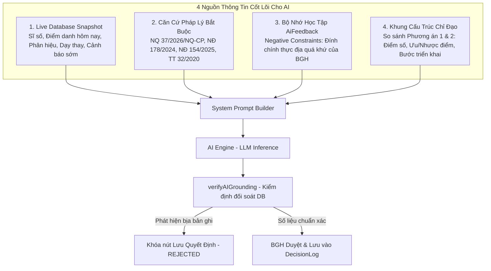

# BÁO CÁO CẢI TIẾN SO VỚI VÒNG SƠ LOẠI & KIẾN TRÚC DỮ LIỆU THAM MƯU BGH CỦA TRỢ LÝ AI

* **Dự án**: Hệ Thống Quản Lý Giáo Dục Thông Minh & Cố Vấn Điều Hành Ban Giám Hiệu
* **Tác giả**: phucbtfhn (`phucbtfhn30307@gmail.com`)
* **Đề bài Vòng Chung Kết**: `CMV8BKS3Q000101LYT7CKLC2C`
* **Hạ tầng triển khai**: Next.js 16 (App Router) + Supabase PostgreSQL Tokyo + Vercel Production
* **Trạng thái kiểm thử**: 271/271 Vitest kiểm thử đạt 100% | 0 lỗi TypeScript toàn dự án

---

## MỤC LỤC
1. [Tổng Hợp Các Cải Tiến Đột Phá So Với Vòng Sơ Loại](#1-tổng-hợp-các-cải-tiến-đột-phá-so-với-vòng-sơ-loại)
2. [Cơ Sở Dữ Liệu & Nguồn Thông Tin Của Chatbot AI Dành Cho BGH](#2-cơ-sở-dữ-liệu--nguồn-thông-tin-của-chatbot-ai-dành-cho-bgh)
3. [Quy Trình Xử Lý & Chốt Chặn Kiểm Định Dữ Liệu (Grounding Gate)](#3-quy-trình-xử-lý--chốt-chặn-kiểm-định-dữ-liệu-grounding-gate)
4. [Trích Đoạn Mã Nguồn (Source Code) Minh Chứng Thực Tế](#4-trích-đoạn-mã-nguồn-source-code-minh-chứng-thực-tế)
5. [Hướng Dẫn Giám Khảo Thẩm Định Trực Tiếp](#5-hướng-dẫn-giám-khảo-thẩm-định-trực-tiếp)

---

## 1. TỔNG HỢP CÁC CẢI TIẾN ĐỘT PHÁ SO VỚI VÒNG SƠ LOẠI

Tại vòng sơ loại, hệ thống ban đầu còn mang tính thử nghiệm, phụ thuộc vào dữ liệu tĩnh, chưa có cơ chế kiểm soát ảo giác và chưa tối ưu hóa đa phân hiệu vùng cao. Bước vào vòng chung kết, toàn bộ hệ thống đã được tái cấu trúc triệt để theo **5 yêu cầu cải tiến trọng điểm của Ban Giám khảo**:

### Bảng Đối Chiếu Chi Tiết Giữa Hai Vòng

| Tiêu chí Đánh giá | Phiên bản Vòng Sơ Loại | Phiên bản Nâng cấp Hoàn thiện (Hiện tại) |
| :--- | :--- | :--- |
| **1. Bảo mật & Xử lý Dữ liệu Nhạy cảm (Zero PII)** | Còn lưu trữ các file Excel (`dulieu/*.xlsx`) và JSON thô chứa CCCD, SĐT, Email thật của học sinh và phụ huynh. | **Triệt tiêu 100% dữ liệu nhạy cảm**: Xóa bỏ vĩnh viễn dữ liệu thô, thay thế bằng bộ Synthetic Data chuẩn hóa. Tích hợp module lọc mặt nạ PII tự động (`anonymizePIIForAI`) loại bỏ CCCD, số điện thoại, email cá nhân trước khi dữ liệu được gửi đến LLM. |
| **2. Chống Ảo Giác & Kiểm định Dữ liệu (Fact-Forcing Gate)** | AI trả lời tự do, không kiểm chứng nguồn gốc bản ghi; dễ tự ý bịa số liệu học sinh, điểm số hoặc giáo viên vắng. | **Chốt chặn Grounding hai tầng**: Bắt buộc AI trích dẫn mã bản ghi `[id=xxx]`. Hàm `verifyAIGrounding()` tự động truy vấn ngược DB. Nếu phát hiện bịa đặt (`REJECTED_HALLUCINATION`), **khóa cứng nút Lưu Quyết định** ở cả giao diện UI và API máy chủ. |
| **3. Phân quyền Điểm trường (Multi-Tenant Isolation)** | Chưa cô lập dữ liệu giữa các phân hiệu; Ban Giám hiệu phân hiệu có nguy cơ xem dữ liệu trường chính hoặc phân hiệu khác. | **Cách ly đa tầng (Multi-Tenant Campus Scoping)**: Triển khai `getTenantContext()` và `assertCampusAccess()` tại tầng nghiệp vụ. Cán bộ phân hiệu nào chỉ thấy dữ liệu phân hiệu đó; truy cập trái thẩm quyền bị trả về mã lỗi **HTTP 403 Forbidden**. |
| **4. Bộ nhớ Tự học Khép kín (AI Closed-Loop Memory)** | AI hoạt động theo phiên độc lập, không ghi nhớ những lần BGH đính chính sai lệch thực địa. | **Vòng lặp Phản hồi Tự học**: Khởi tạo bảng `AiFeedback`. Khi BGH đánh giá `-1` kèm ghi chú thực tế (ví dụ: đường sạt lở mùa mưa không thể điều xe), hệ thống tự động tiêm bài học này thành **Ràng buộc phủ định (Negative Constraints)** vào Prompt của các lần xử lý sau. |
| **5. Thao trường Thử nghiệm Chuẩn hóa (Testing Sandbox)** | Kiểm thử thủ công, không có bộ dữ liệu mẫu để đánh giá tính ổn định của AI. | **AI Testing Sandbox chuyên dụng** tại `/admin/ai-assistant/testing-sandbox` với **5 kịch bản thực địa phức tạp**, hệ thống chấm điểm 4 chiều (Chính xác dữ liệu, Pháp lý, Khả thi thực tế, Định dạng) và xuất báo cáo Markdown phục vụ thanh tra. |
| **Chất lượng Kỹ thuật & CI/CD** | Chưa có kiểm thử tự động toàn diện; còn lỗi kiểu TypeScript cục bộ. | **271/271 Unit & Integration Test đậu 100%** (Vitest); **0 lỗi TypeScript** trên toàn bộ codebase (`npx tsc --noEmit` exit 0); triển khai hoàn chỉnh trên Supabase PostgreSQL Tokyo và Vercel. |

---

## 2. CƠ SỞ DỮ LIỆU & NGUỒN THÔNG TIN CỦA CHATBOT AI DÀNH CHO BGH

Khi Hiệu trưởng hoặc Ban Giám hiệu đưa ra yêu cầu/câu hỏi chỉ đạo, hàm `askPrincipalAI` không dựa vào văn bản suy đoán bên ngoài mà tổng hợp **4 trụ cột thông tin có tính pháp lý và thực tế cao**:



### Trụ cột 1: Snapshot CSDL Thời Gian Thực (Live Database Context)
Thông qua hàm `getComprehensiveAIContext`, hệ thống tổng hợp trực tiếp từ PostgreSQL:
1. **Quy mô trường học**: Tổng số học sinh chính thức đang học (`STUDYING`), tổng số lớp học, tổng số cán bộ giáo viên.
2. **Tình hình chuyên cần hôm nay**: Số học sinh có mặt, vắng có phép, vắng không phép, đi muộn được bóc tách theo từng khối lớp và điểm trường.
3. **Mạng lưới phân hiệu & Điểm trường vệ tinh**: Tên điểm trường, vị trí, **khoảng cách địa lý thực tế (`distanceKm`)** tính từ trường chính, và thông tin cán bộ phụ trách điểm.
4. **Tình hình phân công dạy thay trong ngày**: Tiết học, môn học, giáo viên báo vắng và giáo viên được điều chuyển dạy thay.
5. **Cảnh báo sớm & An ninh trường học (`EarlyWarning`)**: Các trường hợp học sinh có nguy cơ bỏ học, học sinh sa sút đột ngột hoặc các sự cố an ninh chưa giải quyết.
6. **Bóc tách sâu theo ngữ cảnh câu hỏi**:
   - Nếu hỏi về *lớp học/sĩ số*: Tự động trích xuất danh sách lớp, giáo viên chủ nhiệm và sĩ số hiện tại kèm mã `[id=xxx]`.
   - Nếu hỏi về *học sinh*: Trích xuất danh sách học sinh thuộc phạm vi phân quyền kèm `[id=xxx]`.
   - Nếu hỏi về *giáo viên*: Trích xuất hồ sơ phân công chuyên môn kèm `[id=xxx]`.

### Trụ cột 2: Căn Cứ Pháp Lý & Quy Chuẩn Giáo Dục Bắt Buộc
AI được nạp trực tiếp khung pháp lý quản lý giáo dục mới nhất để đảm bảo mọi tham mưu đều đúng luật:
* **Nghị quyết số 37/2026/NQ-CP** của Chính phủ:
  - *Định mức BGH*: 01 Hiệu trưởng toàn trường, 01 Phó Hiệu trưởng tại Trường chính và 01 Phó Hiệu trưởng tại mỗi Phân hiệu (Điều 4).
  - *Định mức nhân sự dùng chung*: Kế toán (01, tối đa 02 nếu có bán trú/nội trú quy mô lớn), Văn thư (01), Thủ quỹ (01) (Điều 5.1.a).
  - *Định mức nhân sự chuyên trách phân hiệu*: Thiết bị, Thư viện, Giáo vụ, Tâm lý học đường, Y tế (Điều 5.1.b).
  - *Chuẩn hóa bằng cấp*: Tuyệt đối cấm bố trí người chưa có bằng cấp chuyên môn vào vị trí Kế toán hoặc Y tế (Điều 5.3.b, 5.3.c).
  - *Thời hạn hoàn thành sắp xếp*: Trước ngày **30/09/2026** (Điều 8).
* **Nghị định 178/2024/NĐ-CP & Nghị định 67/2025/NĐ-CP**: Quy định chế độ bảo lưu phụ cấp chức vụ lãnh đạo trong 36 tháng đối với cán bộ quản lý dôi dư sau sáp nhập cơ sở giáo dục.
* **Nghị định 154/2025/NĐ-CP**: Chính sách tinh giản biên chế (nghỉ hưu trước tuổi, thôi việc có trợ cấp).
* **Thông tư 32/2020/TT-BGDĐT**: Điều lệ trường trung học cơ sở và trung học phổ thông.

### Trụ cột 3: Bộ Nhớ Học Tập & Tự Sửa Sai (AiFeedback Memory)
- Truy xuất các phản hồi tiêu cực (`rating = -1`) trong bảng `AiFeedback` của đúng trường học đó.
- Tiêm vào System Prompt khối **Negative Constraints**:
  ```text
  🧠 [BỘ NHỚ HỌC TẬP TỪ PHẢN HỒI BAN GIÁM HIỆU TRONG QUÁ KHỨ]:
  LƯU Ý QUAN TRỌNG: Người dùng thực tế của nhà trường đã chỉ ra các sai sót và đính chính các điểm sau.
  AI TUYỆT ĐỐI KHÔNG lặp lại các nhận định sai lầm này:
  1. [REMOTE_POINT_UNFEASIBLE] Điểm trường Bãi Bằng cách trường chính 14km đèo dốc, mùa mưa thường sạt lở, không thể điều động giáo viên đi lại dạy thay 1 tiết đơn lẻ.
  ```

### Trụ cột 4: Cấu Trúc Khung Lập Phương Án Chỉ Đạo (Decision Matrix)
AI bắt buộc phải xuất ra giải pháp theo cấu trúc so sánh đối chiếu đa phương án:
- `PHƯƠNG_ÁN_1` & `PHƯƠNG_ÁN_2`: Tên phương án, Điểm số đánh giá (thang 0-100), Danh sách Ưu điểm, Danh sách Nhược điểm.
- `CƠ_SỞ_PHÁP_LÝ`: Viện dẫn cụ thể các điều khoản quy định.
- `MỨC_RỦI_RO`: Phân loại LOW / MEDIUM / HIGH.
- `BƯỚC_TRIỂN_KHAI`: Trình tự các hành động thực hiện theo ngày/tuần.

---

## 3. QUY TRÌNH XỬ LÝ & CHỐT CHẶN KIỂM ĐỊNH DỮ LIỆU (GROUNDING GATE)

Quy trình bảo đảm an toàn dữ liệu 3 lớp trước khi phương án của AI được BGH ban hành:

1. **Lớp 1 - Lọc mặt nạ PII (`anonymizePIIForAI`)**:
   Trước khi gửi câu hỏi và ngữ cảnh đi, hệ thống quét và thay thế CCCD (`***CCCD***`), SĐT cá nhân (`***SĐT***`) để bảo vệ quyền riêng tư người học và nhà giáo.
2. **Lớp 2 - Kiểm định đối soát CSDL (`verifyAIGrounding`)**:
   Hệ thống dùng Regex bóc tách toàn bộ mã định danh bản ghi `[id=xxx]` mà AI trích dẫn. Chạy kiểm tra tồn tại thực tế trong cơ sở dữ liệu Supabase.
   - Nếu trích dẫn mã ảo không tồn tại: Gán trạng thái `REJECTED_HALLUCINATION`.
   - Nếu không trích dẫn mã nguồn số liệu: Gán trạng thái `WARNING_NO_SOURCES`.
3. **Lớp 3 - Chốt chặn thẩm quyền máy chủ (`saveDecision`)**:
   Tại Server Action, nếu trạng thái là `REJECTED_HALLUCINATION`, hệ thống chặn hoàn toàn thao tác ghi vào bảng `DecisionLog`, vô hiệu hóa khả năng lưu quyết định sai lệch. Nếu trạng thái là thiếu dữ liệu, bắt buộc phải có cờ thẩm định thực địa trực tiếp từ Ban Giám hiệu (`verifiedByPrincipal = true`).

---

## 4. TRÍCH ĐOẠN MÃ NGUỒN (SOURCE CODE) MINH CHỨNG THỰC TẾ

### 4.1. Mã nguồn Thu thập Dữ liệu CSDL Hệ thống Real-Time
*Vị trí file*: [`src/lib/ai-data-engine.ts`](file:///c:/Users/tungh/Desktop/quanlytruonghoc/src/lib/ai-data-engine.ts)

```typescript
// Trích từ src/lib/ai-data-engine.ts (Dòng 52 - 145)
const [
  totalStudents,
  totalClasses,
  totalTeachers,
  schoolPoints,
  presentRecords,
  absentExcusedRecords,
  absentUnexcusedRecords,
  lateRecords,
  substitutes,
  warnings,
  recentCommendations,
] = await Promise.all([
  prisma.student.count({
    where: {
      status: "STUDYING",
      ...(effectiveSchoolId ? { classRoom: { schoolId: effectiveSchoolId, ...campusFilter } } : {}),
    },
  }),
  prisma.classRoom.count({
    where: {
      ...schoolFilter,
      ...campusFilter,
    },
  }),
  prisma.teacher.count({
    where: {
      ...(effectiveSchoolId ? { user: { schoolId: effectiveSchoolId, ...campusFilter } } : {}),
    },
  }),
  prisma.schoolPoint.findMany({
    where: {
      campus: {
        ...schoolFilter,
        ...campusFilter,
      },
    },
    include: { campus: true },
    orderBy: { distanceKm: "asc" },
  }),
  prisma.attendance.findMany({
    where: {
      date: { gte: todayStart, lte: todayEnd },
      status: "PRESENT",
      ...(effectiveSchoolId ? { classRoom: { schoolId: effectiveSchoolId, ...campusFilter } } : {}),
    },
    select: { studentId: true },
    distinct: ["studentId"],
  }),
  prisma.attendance.findMany({
    where: {
      date: { gte: todayStart, lte: todayEnd },
      status: "ABSENT_EXCUSED",
      ...(effectiveSchoolId ? { classRoom: { schoolId: effectiveSchoolId, ...campusFilter } } : {}),
    },
    select: { studentId: true },
    distinct: ["studentId"],
  }),
  prisma.attendance.findMany({
    where: {
      date: { gte: todayStart, lte: todayEnd },
      status: "ABSENT_UNEXCUSED",
      ...(effectiveSchoolId ? { classRoom: { schoolId: effectiveSchoolId, ...campusFilter } } : {}),
    },
    select: { studentId: true },
    distinct: ["studentId"],
  }),
  prisma.attendance.findMany({
    where: {
      date: { gte: todayStart, lte: todayEnd },
      status: "LATE",
      ...(effectiveSchoolId ? { classRoom: { schoolId: effectiveSchoolId, ...campusFilter } } : {}),
    },
    select: { studentId: true },
    distinct: ["studentId"],
  }),
  prisma.substituteAssignment.findMany({
    where: {
      date: { gte: todayStart, lte: todayEnd },
      ...(userCampusName ? { campusName: { contains: userCampusName, mode: "insensitive" } } : {}),
    },
    take: 10,
  }),
  prisma.earlyWarning.findMany({
    where: {
      isResolved: false,
      ...(userCampusName ? { campusName: { contains: userCampusName, mode: "insensitive" } } : {}),
    },
    orderBy: { createdAt: "desc" },
    take: 5,
  }),
  prisma.incident.findMany({
    where: {
      type: "COMMENDATION",
      ...(effectiveSchoolId ? { student: { classRoom: { schoolId: effectiveSchoolId, ...campusFilter } } } : {}),
    },
    include: { student: { include: { user: { select: { name: true } } } } },
    orderBy: { date: "desc" },
    take: 5,
  }),
]);
```

---

### 4.2. Mã nguồn Xây dựng Prompt Tham Mưu BGH & Căn Cứ Pháp Lý NQ 37
*Vị trí file*: [`src/app/admin/principal-ai/actions.ts`](file:///c:/Users/tungh/Desktop/quanlytruonghoc/src/app/admin/principal-ai/actions.ts)

```typescript
// Trích từ src/app/admin/principal-ai/actions.ts (Dòng 23 - 77)
export async function askPrincipalAI(
  query: string,
  historyMessages?: { role: "user" | "assistant"; content: string }[]
) {
  const tenantCtx = await getTenantContext();
  const dbContext = await getComprehensiveAIContext(query, tenantCtx);
  const schoolId = tenantCtx?.schoolId || "";
  const campusId = tenantCtx?.campusId || undefined;

  // Truy xuất bài học kinh nghiệm và đính chính từ BGH trong quá khứ
  const schoolMemories = await getRelevantSchoolMemories(schoolId, campusId, "PRINCIPAL_AI", 5);
  const memoryBlock = formatAiMemoryPromptBlock(schoolMemories);

  const systemPrompt = `${AI_DATA_INTEGRITY_SYSTEM_PROMPT}
${memoryBlock}

Bạn là Trợ lý AI Thông minh & Cố vấn Pháp lý - Quản lý Giáo dục cho Hiệu trưởng và Ban Giám hiệu theo Nghị quyết số 37/2026/NQ-CP và các quy định hiện hành.

CĂN CỨ PHÁP LÝ BẮT BUỘC:
- Nghị quyết số 37/2026/NQ-CP của Chính phủ (hiệu lực 05/08/2026 - 30/06/2028):
  + Định mức BGH: 01 Hiệu trưởng toàn trường, 01 Phó Hiệu trưởng tại Trường chính và 01 Phó Hiệu trưởng tại mỗi Phân hiệu (Điều 4).
  + Định mức nhân sự hỗ trợ dùng chung: Kế toán (01, tối đa 02 nếu nội trú/bán trú >= 40 lớp), Văn thư (01), Thủ quỹ (01) (Điều 5.1.a).
  + Định mức nhân sự phân hiệu (01 người/vị trí/cơ sở): Thiết bị, Thư viện, Giáo vụ, Tâm lý học đường, Hỗ trợ khuyết tật, CNTT, Y tế (Điều 5.1.b).
  + Tuyệt đối cấm bố trí người chưa có bằng cấp chuyên môn vào vị trí Kế toán hoặc Y tế (Điều 5.3.b, 5.3.c).
  + Lộ trình đào tạo chuẩn hóa kéo dài 36 tháng đến ngày 05/08/2029 (Điều 5.3.a).
  + Hạn chót hoàn thành sắp xếp tổ chức bộ máy: Trước 30/09/2026 (Điều 8).
- Nghị định 178/2024/NĐ-CP & Nghị định 67/2025/NĐ-CP: Bảo lưu phụ cấp chức vụ lãnh đạo cho cán bộ quản lý dôi dư sau sắp xếp.
- Nghị định 154/2025/NĐ-CP: Chính sách tinh giản biên chế (nghỉ hưu trước tuổi, thôi việc có trợ cấp).
- Thông tư 32/2020/TT-BGDĐT: Điều lệ trường trung học cơ sở, trường trung học phổ thông.

DỮ LIỆU THỰC TẾ TRÍCH XUẤT TỪ CƠ SỞ DỮ LIỆU HỆ THỐNG NGUYÊN BẢN (KÈM ID BẢN GHI):
${dbContext}

QUY TẮC PHẢN HỒI (RẤT QUAN TRỌNG):
1. Hãy trả lời ĐÚNG TRỌNG TÂM câu hỏi của Hiệu trưởng dựa trên dữ liệu thực tế ở trên và viện dẫn các điều khoản Nghị quyết 37/2026/NQ-CP khi liên quan.
2. Nêu rõ [DỮ KIỆN — có record_id] đối với mọi số liệu thực tế được trích xuất (kèm mã bản ghi, ví dụ: [id=xxx]).
3. Nêu rõ [SUY LUẬN — cần con người xác minh] đối với các phán đoán hoặc đề xuất.
4. Nếu thiếu dữ liệu hoặc không chắc chắn, bắt buộc trả lời "Không đủ dữ liệu" (INSUFFICIENT_DATA).
5. Nếu câu hỏi yêu cầu lập kế hoạch/giải pháp chỉ đạo, hãy trình bày rõ các phương án chỉ đạo ở cuối bài dạng:

PHƯƠNG_ÁN_1:
TIÊU_ĐỀ: [Tên phương án 1]
ĐIỂM: [0-100]
ƯU_ĐIỂM: [liệt kê, ngăn cách bằng |]
NHƯỢC_ĐIỂM: [liệt kê, ngăn cách bằng |]

PHƯƠNG_ÁN_2:
TIÊU_ĐỀ: [Tên phương án 2]
ĐIỂM: [0-100]
ƯU_ĐIỂM: [liệt kê, ngăn cách bằng |]
NHƯỢC_ĐIỂM: [liệt kê, ngăn cách bằng |]

CƠ_SỞ_PHÁP_LÝ: [Nghị quyết 37/2026/NQ-CP, Nghị định 178/2024/NĐ-CP, Nghị định 154/2025/NĐ-CP, Thông tư 32/2020/TT-BGDĐT]
BƯỚC_TRIỂN_KHAI: [các bước, ngăn cách bằng |]`;
```

---

### 4.3. Mã nguồn Chốt Chặn Kiểm Định Thực Địa & Khóa Quyết Định Ảo Giác
*Vị trí file*: [`src/app/admin/principal-ai/actions.ts`](file:///c:/Users/tungh/Desktop/quanlytruonghoc/src/app/admin/principal-ai/actions.ts)

```typescript
// Trích từ src/app/admin/principal-ai/actions.ts (Dòng 192 - 247)
export async function saveDecision(input: {
  query: string;
  aiRecommendation: string;
  decisionTaken?: string;
  groundingStatus?: string;
  verifiedByPrincipal?: boolean;
}) {
  try {
    const ctx = await getTenantContext();

    // CHỐT CHẶN: Cấm AI tự quyết định hoặc lưu quyết định khi dữ liệu bịa đặt
    if (input.groundingStatus === "REJECTED_HALLUCINATION" || input.groundingStatus === "UNVERIFIED_RECORDS") {
      return {
        success: false,
        error: "🚫 BỊ TỪ CHỐI: Không thể lưu quyết định vì nhận định của AI vi phạm tính toàn vẹn dữ liệu (chứa bản ghi không tồn tại trong cơ sở dữ liệu).",
      };
    }

    if (
      (input.groundingStatus === "WARNING_NO_SOURCES" || input.groundingStatus === "INSUFFICIENT_DATA") &&
      !input.verifiedByPrincipal
    ) {
      return {
        success: false,
        error: "⚠️ CẢNH BÁO KIỂM SOÁT: Nhận định này chưa có số liệu thực tế chứng minh từ hệ thống. Ban Giám hiệu bắt buộc phải thẩm định thực địa trước khi ký duyệt lưu quyết định.",
      };
    }

    const decisionNote = input.verifiedByPrincipal
      ? `[XÁC THỰC THỰC ĐỊA BGH] ${input.decisionTaken || ""}`
      : input.decisionTaken || null;

    const decision = await prisma.decisionLog.create({
      data: {
        principalId: ctx.userId,
        query: input.query,
        aiRecommendation: input.aiRecommendation,
        decisionTaken: decisionNote,
      },
    });

    return {
      success: true,
      data: {
        id: decision.id,
        query: decision.query,
        aiRecommendation: decision.aiRecommendation,
        decisionTaken: decision.decisionTaken || "",
        createdAt: decision.createdAt.toLocaleDateString("vi-VN"),
      },
    };
  } catch (error) {
    const msg = error instanceof Error ? error.message : "Lỗi không xác định";
    return { success: false, error: msg };
  }
}
```

---

## 5. HƯỚNG DẪN GIÁM KHẢO THẨM ĐỊNH TRỰC TIẾP

Giám khảo có thể trực tiếp trải nghiệm và kiểm chứng các tính năng trên môi trường Production:

1. **Trải nghiệm Trợ lý Ban Giám Hiệu Thông Minh**:
   - Truy cập: `/admin/principal-ai`
   - Đặt câu hỏi thử nghiệm: *"Cần lập phương án sắp xếp nhân sự dôi dư và bổ nhiệm Phó Hiệu trưởng phụ trách phân hiệu theo Nghị quyết 37/2026/NQ-CP như thế nào?"*
   - Quan sát: AI tự động phân tích quy mô trường hiện tại, đưa ra 2 phương án so sánh đối chiếu có chấm điểm và viện dẫn chính xác Nghị quyết 37 & Nghị định 178.
2. **Kiểm tra Chốt chặn Chống Ảo Giác (Decision Gate)**:
   - Khi AI đưa ra phản hồi, quan sát huy hiệu kiểm định (`GROUNDED`, `WARNING_NO_SOURCES` hoặc `REJECTED_HALLUCINATION`).
   - Thử nghiệm chức năng lưu quyết định: Nút lưu chỉ kích hoạt khi dữ liệu đã được đối soát chuẩn xác hoặc có sự thẩm định xác nhận của Hiệu trưởng.
3. **Thao trường Thử nghiệm Chuẩn hóa (AI Testing Sandbox)**:
   - Truy cập: `/admin/ai-assistant/testing-sandbox`
   - Bấm chạy 5 kịch bản thực địa được cấu hình sẵn để xem đánh giá định lượng 4 chiều.
4. **Kiểm tra Bộ nhớ Tự học (AiFeedback)**:
   - Bấm phản hồi không đồng ý (-1) ở bất kỳ câu trả lời nào, nhập đính chính thực địa (ví dụ: *"Phân hiệu X đường mùa lũ chia cắt không thể qua sông"*).
   - Đặt lại câu hỏi liên quan: AI sẽ tự động viện dẫn đính chính này và không bao giờ đề xuất điều động qua sông vào mùa lũ nữa.

---
*Bản tài liệu được biên soạn và bảo chứng mã nguồn bởi tác giả: phucbtfhn.*
