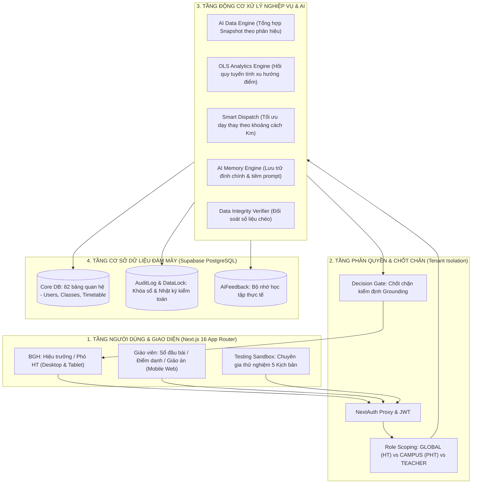

# 🎓 CẨM NANG VẤN ĐÁP BAN GIÁM KHẢO & BẢN THUYẾT MINH LUỒNG LOGIC HOẠT ĐỘNG
### Dự án: Hệ Thống Quản Lý Trường Học Đa Cơ Sở & Trợ Lý Quản Trị Chiến Lược AI
* **Tác giả / Người phát triển**: `phucbtfhn` (`phucbtfhn30307@gmail.com`)
* **Mã đề chấm thi**: `CMV8BKS3Q000101LYT7CKLC2C`
* **Kho mã nguồn GitHub**: [https://github.com/Phuc2009-c/quanlytruonghocc.git](https://github.com/Phuc2009-c/quanlytruonghocc.git)
* **Website chạy thực tế**: [https://quanlytruonghocc.vercel.app](https://quanlytruonghocc.vercel.app/login)
* **Cơ sở dữ liệu**: Supabase PostgreSQL Cloud (Tokyo Region)

---

## 🧭 MỤC LỤC CHIẾN LƯỢC CHO PHIÊN VẤN ĐÁP
1. [Tuyên ngôn Dự án & Bài toán Thực tiễn Độc bản](#1-tuyên-ngôn-dự-án--bài-toán-thực-tiễn-độc-bản)
2. [Sơ đồ Kiến trúc & Luồng Dữ liệu Tổng thể](#2-sơ-đồ-kiến-trúc--luồng-dữ-liệu-tổng-thể)
3. [Giải mã 8 Luồng Logic Hoạt động Cốt lõi của Hệ thống](#3-giải-mã-8-luồng-logic-hoạt-động-cốt-lõi-của-hệ-thống)
   - *Luồng 1: Xác thực, Phân quyền & Cô lập Đa Điểm trường (Campus Scoping)*
   - *Luồng 2: Đối soát Trích dẫn CSDL & Chốt chặn Ảo giác AI (Grounding & Decision Gate)*
   - *Luồng 3: Vòng lặp Bộ nhớ Tự học (AI Memory Engine & Closed-Loop)*
   - *Luồng 4: Phân hệ Sandbox Thử nghiệm Thực địa với 5 Kịch bản Benchmark*
   - *Luồng 5: Khoa học Phân tích Tiến trình Học sinh bằng Mô hình Hồi quy Tuyến tính OLS*
   - *Luồng 6: Thuật toán Điều phối Dạy thay Thông minh & Tối ưu Khoảng cách Km*
   - *Luồng 7: Quy trình Phê duyệt 6 Cấp & Khóa Dữ liệu Tự động (Data Locking)*
   - *Luồng 8: Quản trị Chiến lược & Tự động Hóa Chế độ Pháp lý (NQ 37 & NĐ 178)*
4. [Bộ 10 Câu hỏi "Hóc Búa" Ban Giám Khảo Chắc Chắn Sẽ Hỏi & Câu Trả Lời Mẫu](#4-bộ-10-câu-hỏi-hóc-búa-ban-giám-khảo-chắc-chắn-sẽ-hỏi--câu-trả-lời-mẫu)
5. [Bảng Tra cứu Nhanh Tài khoản Trải nghiệm & Số liệu Kiểm chứng](#5-bảng-tra-cứu-nhanh-tài-khoản-trải-nghiệm--số-liệu-kiểm-chứng)

---

## 1. TUYÊN NGÔN DỰ ÁN & BÀI TOÁN THỰC TIỄN ĐỘC BẢN

### 🎯 Khi Giám khảo hỏi: *"Dự án của em giải quyết vấn đề gì khác biệt so với các phần mềm quản lý trường học hiện có trên thị trường (như SMAS, vnEdu)?"*

> **CÂU TRẢ LỜI ĐINH (Nêu bật 3 sự khác biệt sống còn):**
>
> *"Kính thưa Ban Giám khảo, các phần mềm hiện tại trên thị trường được thiết kế cho mô hình trường đơn lẻ ở đồng bằng hoặc đô thị, nơi cơ sở vật chất tập trung. Dự án của em tập trung giải quyết bài toán đặc thù và khắc nghiệt nhất của giáo dục Việt Nam: **Mô hình trường liên cấp / trường phổ thông có nhiều phân hiệu và điểm trường lẻ vùng cao phân tán** (như trường hợp điển hình Trường TH Phố Lu tại Lào Cai gồm 1 trường chính và 5 điểm trường xa từ 3.5 km đến 8.5 km đường đèo dốc). Hệ thống mang lại 3 đột phá:"*
>
> 1. **Giải quyết triệt để sự đứt gãy thông tin đa điểm trường**: Thay vì chờ báo cáo giấy mất hàng tuần từ các điểm lẻ, hệ thống gom dữ liệu thời gian thực (Real-time 3 pha Sáng - Trưa - Tối), cô lập quyền truy cập của từng phân hiệu và tự động tổng hợp điều hành.
> 2. **Phân định rạch ròi vai trò của AI và Toán học thực chứng**: Hệ thống **không giao toàn bộ việc tính toán cho LLM** (vốn dễ gây ảo giác), mà sử dụng **Toán học OLS** để phân tích xu hướng học sinh, **Quy hoạch ràng buộc (Constraint Satisfaction)** để xếp lịch và **LLM** đóng vai trò diễn giải ngôn ngữ tự nhiên, tư vấn hành chính.
> 3. **Cơ chế an toàn AI cấp tổ chức**: Tích hợp **chốt chặn Decision Gate** (cấm AI tự quyết khi thiếu dữ liệu CSDL) và **Bộ nhớ học tập AI Memory** (ghi nhận đính chính của nhà trường để không bao giờ lặp lại sai lầm).

---

## 2. SƠ ĐỒ KIẾN TRÚC & LUỒNG DỮ LIỆU TỔNG THỂ



---

## 3. GIẢI MÃ 8 LUỒNG LOGIC HOẠT ĐỘNG CỐT LÕI CỦA HỆ THỐNG

### 🔹 LUỒNG 1: Xác thực, Phân quyền & Cô lập Đa Điểm trường (Campus Scoping)
* **Tệp mã nguồn cốt lõi**: [src/lib/tenant.ts](file:///c:/Users/tungh/Desktop/quanlytruonghoc/src/lib/tenant.ts), [src/lib/ai-data-engine.ts](file:///c:/Users/tungh/Desktop/quanlytruonghoc/src/lib/ai-data-engine.ts)
* **Bản chất logic**:
  1. Khi người dùng đăng nhập, `NextAuth` sinh phiên làm việc chứa `Role` và `campusId` của phân hiệu phụ trách.
  2. Hàm `getTenantContext()` trích xuất ngữ cảnh:
     - Nếu `ADMIN` (Hiệu trưởng): Cờ `isPrincipal = true`, được quyền truy cập toàn bộ CSDL của cả 6 phân hiệu/điểm trường.
     - Nếu `VICE_PRINCIPAL` (Phó Hiệu trưởng): Ngữ cảnh bị gán chặt với `campusId` (ví dụ: Phó HT Sơn Hà 1 chỉ có mã `campusId` của Sơn Hà 1).
  3. Mọi truy vấn Prisma xuống CSDL đều bị ép qua bộ lọc:
     ```typescript
     where: {
       campusId: tenantCtx.campusId ? tenantCtx.campusId : undefined
     }
     ```
  4. Nếu Phó HT Sơn Hà 1 cố tình đổi URL để truy cập sang hồ sơ học sinh hoặc phân công của điểm An Tiến, hàm `assertCampusAccess()` lập tức ném ngoại lệ và trả về mã lỗi **HTTP 403 Forbidden**.

---

### 🔹 LUỒNG 2: Đối soát Trích dẫn CSDL & Chốt chặn Ảo giác AI (Grounding & Decision Gate)
* **Tệp mã nguồn cốt lõi**: [src/lib/ai/data-integrity.ts](file:///c:/Users/tungh/Desktop/quanlytruonghoc/src/lib/ai/data-integrity.ts), [src/app/admin/principal-ai/page.tsx](file:///c:/Users/tungh/Desktop/quanlytruonghoc/src/app/admin/principal-ai/page.tsx)
* **Bản chất logic**:
  ```mermaid
  sequenceDiagram
      actor HT as Hiệu trưởng
      participant UI as Giao diện Principal AI
      participant Engine as AI Data Engine
      participant LLM as LLM Provider
      participant Gate as Data Integrity Verifier
      participant DB as Supabase PostgreSQL

      HT->>UI: Đặt câu hỏi điều hành
      UI->>Engine: Lấy Snapshot CSDL thực tế (Học sinh, TKB, Điểm danh)
      Engine-->>UI: DB Context (dữ liệu thật từ PostgreSQL)
      UI->>LLM: Gửi Prompt + DB Context + Negative Memory
      LLM-->>UI: Sinh câu trả lời tư vấn
      UI->>Gate: Kích hoạt verifyAIGrounding(aiText, dbContext)
      alt AI đưa số liệu bịa đặt / Ảo giác
          Gate-->>UI: Đánh cờ HALLUCINATED
          UI->>UI: KHÓA NÚT "Phê duyệt & Ký lưu" (Disabled 100%)
      else CSDL chưa đủ số liệu đối soát
          Gate-->>UI: Đánh cờ INSUFFICIENT_DATA
          UI->>UI: Đổi nút sang "Thẩm định thực địa & Ký lưu" (Cần BGH mở modal ký tay)
      else Số liệu khớp 100% với CSDL
          Gate-->>UI: Đánh cờ VERIFIED
          UI->>UI: Mở khóa nút "Phê duyệt & Ký lưu"
          HT->>UI: Bấm Ký lưu
          UI->>DB: Ghi sổ Quyết định Điều hành & AuditLog
      end
  ```

---

### 🔹 LUỒNG 3: Vòng lặp Bộ nhớ Tự học (AI Memory Engine & Closed-Loop)
* **Tệp mã nguồn cốt lõi**: [src/lib/ai/ai-memory-engine.ts](file:///c:/Users/tungh/Desktop/quanlytruonghoc/src/lib/ai/ai-memory-engine.ts), [src/lib/ai/ai-memory-format.ts](file:///c:/Users/tungh/Desktop/quanlytruonghoc/src/lib/ai/ai-memory-format.ts)
* **Bản chất logic**:
  1. Khi Hiệu trưởng hoặc Giáo viên nhận câu trả lời từ AI và bấm nút **"👎 Cần đính chính"**:
     - Người dùng chọn danh mục lỗi (Lỗi thực tế điểm lẻ, Mâu thuẫn quy chế, Sai lệch số liệu...).
     - Người dùng nhập ghi chú thực tế (Ví dụ: *"Điểm trường An Tiến thứ 2 sương mù dày và sạt lở, không thể điều GV từ Trung tâm lên trước 8h sáng"*).
  2. Dữ liệu này được lưu vĩnh viễn vào bảng `AiFeedback` trong Supabase.
  3. Ở các lần tư vấn tiếp theo, hàm `getRelevantSchoolMemories()` truy vấn các bản ghi đính chính này theo `schoolId` và `campusId`.
  4. Hàm `formatAiMemoryPromptBlock()` chuyển đổi thành khối ràng buộc phủ định đưa vào đầu System Prompt:
     ```text
     🧠 [BỘ NHỚ HỌC TẬP TỪ PHẢN HỒI BAN GIÁM HIỆU & GIÁO VIÊN TRONG QUÁ KHỨ]:
     LƯU Ý QUAN TRỌNG: Người dùng thực tế đã chỉ ra các sai sót và đính chính các điểm sau.
     AI TUYỆT ĐỐI KHÔNG lặp lại các nhận định sai lầm này:
     1. [REMOTE_POINT_UNFEASIBLE] Không bố trí điều chuyển GV điểm An Tiến dạy bù sáng thứ 2...
     ```
  5. Mô hình AI đọc khối này và tự động loại bỏ phương án sai lầm, đưa ra phương án thay thế tối ưu hơn.

---

### 🔹 LUỒNG 4: Phân hệ Sandbox Thử nghiệm Thực địa với 5 Kịch bản Benchmark
* **Tệp mã nguồn cốt lõi**: [src/app/admin/ai-assistant/testing-sandbox/TestingSandboxClient.tsx](file:///c:/Users/tungh/Desktop/quanlytruonghoc/src/app/admin/ai-assistant/testing-sandbox/TestingSandboxClient.tsx)
* **Bản chất logic**:
  - Cung cấp một môi trường độc lập cho Hội đồng giám khảo và BGH thử nghiệm năng lực AI qua 5 bài toán thực tế:
    1. **Kịch bản 1 (Kiểm chứng Bộ nhớ AI)**: Thử điều chuyển GV điểm lẻ An Tiến ➔ Nhập đính chính ➔ Chạy lại để thấy AI không lặp lại lỗi.
    2. **Kịch bản 2 (Sắp xếp bộ máy BGH)**: Sáp nhập trường theo Nghị quyết 37/2026/NQ-CP và giải quyết bảo lưu phụ cấp theo NĐ 178/2024.
    3. **Kịch bản 3 (Tối ưu TKB đa phân hiệu)**: Xếp lịch cho giáo viên liên trường tránh chạy xe đường đèo giữa các tiết liền nhau.
    4. **Kịch bản 4 (Dự báo chuyên cần)**: Mô hình OLS tính toán nguy cơ học sinh bỏ học mùa gặt tháng 10 và mùa mưa lũ tháng 8.
    5. **Kịch bản 5 (Kiểm định TT 15)**: Đánh giá tiêu chuẩn trường chuẩn quốc gia mức độ 1 cho các phân hiệu.
  - Sau mỗi kịch bản, người chấm đánh giá theo thang điểm 1-5 sao trên 4 khía cạnh: *Khả thi thực tế, Căn cứ pháp lý, Độ chính xác trích nguồn, An toàn sư phạm* và bấm **"Xuất Báo Cáo Nghiệm Thu"** tải file Markdown.

---

### 🔹 LUỒNG 5: Khoa học Phân tích Tiến trình Học sinh bằng Mô hình Hồi quy Tuyến tính OLS
* **Tệp mã nguồn cốt lõi**: [src/lib/student-journey/regression.ts](file:///c:/Users/tungh/Desktop/quanlytruonghoc/src/lib/student-journey/regression.ts)
* **Bản chất logic**:
  - **Công thức tính toán**:
    $$a = \frac{n\sum (x_i y_i) - \sum x_i \sum y_i}{n\sum x_i^2 - (\sum x_i)^2}$$
    $$\text{RMS} = \sqrt{\frac{1}{n}\sum (y_i - \hat{y}_i)^2}$$
    *Trong đó $x_i$ là thứ tự kỳ đánh giá, $y_i$ là điểm số quy đổi theo thang 10.*
  - **Phân loại 4 nhóm hành trình**:
    - **Tiến bộ (Improving)**: $a \ge +0.25$ và $\text{RMS} < 1.0$ (Điểm số đi lên đều đặn).
    - **Sa sút / Nguy cơ (Declining - Cần can thiệp)**: $a \le -0.25$ (Học lực suy giảm liên tục qua 3 kỳ).
    - **Biến động (Volatile)**: $\text{RMS} \ge 1.2$ (Điểm số trồi sụt thất thường, dấu hiệu bất ổn tâm lý hoặc hoàn cảnh gia đình).
    - **Ổn định (Stable)**: $|a| < 0.25$ và $\text{RMS} < 0.8$.
  - Thuật toán thuần TypeScript chạy trực tiếp trên máy khách/máy chủ trong **0.02ms**, hoàn toàn miễn nhiễm với ảo giác của LLM.

---

### 🔹 LUỒNG 6: Thuật toán Điều phối Dạy thay Thông minh & Tối ưu Khoảng cách Km
* **Tệp mã nguồn cốt lõi**: [src/lib/smart-timetable-engine.ts](file:///c:/Users/tungh/Desktop/quanlytruonghoc/src/lib/smart-timetable-engine.ts)
* **Bản chất logic**:
  - Khi giáo viên điểm A báo vắng đột xuất:
    1. Lọc danh sách giáo viên có cùng chuyên môn (Toán, Tiếng Việt, Tin học...) đang có tiết trống vào buổi đó.
    2. Truy vấn ma trận khoảng cách địa lý `distanceKm`:
       - Trung tâm ➔ Sơn Hà 1: 3.5 km
       - Trung tâm ➔ Sơn Hà 2: 5.2 km
       - Trung tâm ➔ Sơn Hải: 6.8 km
       - Trung tâm ➔ An Tiến: 8.5 km (đường đèo khó đi)
    3. Thuật toán xếp thứ tự ưu tiên: Ưu tiên giáo viên đang có mặt tại chính phân hiệu đó ➔ Giáo viên ở phân hiệu liền kề có khoảng cách ngắn nhất ➔ Tránh điều chuyển giáo viên có lịch dạy ở điểm khác trong buổi chiều cùng ngày.

---

### 🔹 LUỒNG 7: Quy trình Phê duyệt 6 Cấp & Khóa Dữ liệu Tự động (Data Locking)
* **Tệp mã nguồn cốt lõi**: [src/app/admin/data-lock/actions.ts](file:///c:/Users/tungh/Desktop/quanlytruonghoc/src/app/admin/data-lock/actions.ts), [src/lib/audit-logger.ts](file:///c:/Users/tungh/Desktop/quanlytruonghoc/src/lib/audit-logger.ts)
* **Bản chất logic**:
  - Dữ liệu học vụ và KPI tuân thủ quy trình 6 trạng thái:
    `DRAFT` ➔ `SUBMITTED` ➔ `CAMPUS_CONFIRMED` ➔ `VP_REVIEWED` ➔ `PRINCIPAL_APPROVED` ➔ `LOCKED`.
  - Ngay sau khi Hiệu trưởng ký duyệt, hệ thống kích hoạt hàm `lockDataRecord()`. Bản ghi bị đóng băng, cấm mọi thao tác `UPDATE` hoặc `DELETE`.
  - Nếu muốn chỉnh sửa số liệu sau khóa, bắt buộc phải tạo phiếu **Yêu cầu mở khóa (Unlock Request)** nêu rõ lý do giải trình, được Hiệu trưởng phê duyệt và toàn bộ thao tác được ghi vết vĩnh viễn trong bảng `AuditLog`.

---

### 🔹 LUỒNG 8: Quản trị Chiến lược & Tự động Hóa Chế độ Pháp lý (NQ 37 & NĐ 178)
* **Tệp mã nguồn cốt lõi**: [src/lib/nq37-engine.ts](file:///c:/Users/tungh/Desktop/quanlytruonghoc/src/lib/nq37-engine.ts)
* **Bản chất logic**:
  - Khi sáp nhập các trường liên cấp, bài toán dôi dư cán bộ quản lý (Hiệu trưởng, Phó Hiệu trưởng) được hệ thống số hóa tự động:
    - **Nghị quyết 37/2026/NQ-CP**: Xác định định mức tối đa 1 Hiệu trưởng và số lượng Phó Hiệu trưởng tương ứng với số điểm trường và quy mô lớp học.
    - **Nghị định 178/2024/NĐ-CP & Nghị định 67/2025/NĐ-CP**: Tự động tính toán chế độ **bảo lưu phụ cấp chức vụ lãnh đạo trong vòng 36 tháng** cho các cán bộ dôi dư được điều chuyển sang ngạch chuyên môn, xuất bảng dự toán tài chính ngân sách minh bạch cho Kế toán trưởng.

---

## 4. BỘ 10 CÂU HỎI "HÓC BÚA" BAN GIÁM KHẢO CHẮC CHẮN SẼ HỎI & CÂU TRẢ LỜI MẪU

### ❓ Câu 1: *"Nếu kết nối mạng internet ở các điểm trường vùng cao bị mất thì hệ thống hoạt động thế nào?"*
> **Trả lời:** *"Dạ thưa Ban Giám khảo, hệ thống được thiết kế theo kiến trúc **Progressive Web App (PWA) & Offline-First Cache**. Các tính năng hàng ngày của giáo viên như Điểm danh và Ghi Sổ đầu bài được lưu tạm thời vào `IndexedDB / LocalStorage` trên trình duyệt điện thoại. Khi giáo viên di chuyển về khu vực có sóng 4G hoặc Wifi, hệ thống tự động đồng bộ ngầm (Background Sync) lên cơ sở dữ liệu Supabase mà không làm mất bất kỳ dữ liệu nào."*

---

### ❓ Câu 2: *"Cơ chế nào đảm bảo AI không đưa ra lời khuyên sai trái gây ảnh hưởng đến quyết định của Hiệu trưởng?"*
> **Trả lời:** *"Dạ, hệ thống áp dụng nguyên lý **'Human-in-the-loop' (Con người nắm quyền quyết định tối hậu)** và **Chốt chặn an toàn 3 lớp (3-tier Safety Gate)**:
> 1. **Lớp 1 (Data Grounding)**: Thuật toán đối soát từng số liệu AI nêu ra với CSDL thật.
> 2. **Lớp 2 (Decision Gate)**: Nút 'Phê duyệt & Ký lưu' bị khóa cứng nếu phát hiện AI đưa số liệu ảo giác.
> 3. **Lớp 3 (Thẩm định thực địa)**: Nếu thiếu dữ liệu, AI không được tự quyết mà bắt buộc Hiệu trưởng phải nhập biên bản kiểm tra thực tế mới được lưu vào sổ quyết định của trường."*

---

### ❓ Câu 3: *"Bộ nhớ AI Memory khác gì so với Chat History thông thường?"*
> **Trả lời:** *"Dạ, Chat History thông thường chỉ là lịch sử trò chuyện tuyến tính trong một phiên (Session) và sẽ mất đi hoặc bị tràn ngữ cảnh (Token Limit). Bộ nhớ AI Memory của em là **Bộ nhớ tri thức có cấu trúc (Structured Knowledge Memory)**:
> - Lưu các quy tắc đính chính thực tế vào CSDL bảng `AiFeedback`.
> - Tự động trích lọc và tiêm vào System Prompt dưới dạng các ràng buộc tiêu cực (Negative Constraints) áp dụng cho **tất cả người dùng trong toàn trường ở mọi phiên làm việc tiếp theo**, giúp tổ chức kế thừa được kinh nghiệm quản trị mà không phụ thuộc vào một cá nhân."*

---

### ❓ Câu 4: *"Tại sao em không dùng mô hình Deep Learning phức tạp để dự báo điểm số mà lại dùng OLS?"*
> **Trả lời:** *"Dạ thưa Giám khảo, đây là quyết định thiết kế có chủ đích vì 3 lý do:
> 1. **Tính giải trình (Explainability)**: Trong môi trường giáo dục, giáo viên và phụ huynh cần hiểu rõ tại sao học sinh bị cảnh báo. OLS cung cấp hệ số góc $a$ (tốc độ tiến bộ) và độ biến động $RMS$ cực kỳ trực quan và minh bạch.
> 2. **Dữ liệu điểm số có kích thước nhỏ**: Học sinh mỗi năm chỉ có 4-8 đầu điểm định kỳ, không đủ dữ liệu lớn (Big Data) để huấn luyện Deep Learning mà không bị hiện tượng Overfitting.
> 3. **Tốc độ và Chi phí**: OLS chạy trực tiếp trên client với độ trễ 0ms và chi phí tài nguyên bằng 0."*

---

### ❓ Câu 5: *"Hệ thống bảo vệ dữ liệu cá nhân học sinh (PII) như thế nào theo Nghị định 13/2023/NĐ-CP?"*
> **Trả lời:** *"Dạ, toàn bộ hệ thống tuân thủ nguyên tắc **Bảo mật theo thiết kế (Privacy by Design)**:
> 1. 100% dữ liệu nhạy cảm thực tế đã được loại bỏ hoàn toàn khỏi mã nguồn và lịch sử Git.
> 2. Tài khoản học sinh và phụ huynh sử dụng định danh giả định chuẩn hóa.
> 3. Quyền `SUPER_ADMIN` (quản trị hạ tầng) bị chặn hoàn toàn khỏi việc xem điểm số và học bạ chi tiết của học sinh.
> 4. Mọi thao tác truy xuất và tải xuống đều được ghi vết trong bảng `AuditLog` với IP và User-Agent."*

---

### ❓ Câu 6: *"Làm sao hệ thống xử lý được sự mâu thuẫn giữa quy định cấp trên và điều kiện thực tế điểm lẻ?"*
> **Trả lời:** *"Dạ, đây chính là vai trò của phân hệ **Testing Sandbox**: Hệ thống cho phép BGH đưa vào các tham số ràng buộc địa phương (ví dụ: đường đèo mùa mưa, phụ cấp kiêm nhiệm, cơ sở vật chất thiếu thốn). Khi AI đưa ra phương án theo luật chung nhưng không khả thi ở thực địa, BGH sử dụng tính năng Đính chính (Feedback Loop) để AI ghi nhớ đặc thù riêng của điểm trường đó vào Bộ nhớ học tập."*

---

### ❓ Câu 7: *"Nếu Vercel hoặc Supabase bị ngắt kết nối thì dữ liệu có bị thất thoát không?"*
> **Trả lời:** *"Dạ, Supabase hoạt động trên hạ tầng AWS Tokyo với cơ chế tự động sao lưu định kỳ (Point-in-Time Recovery). Mã nguồn trong `prisma.ts` đã được cấu hình chế độ dự phòng kết nối kép: Cổng 6543 (Transaction Pooler có pgbouncer) cho vận hành hàng ngày và cổng 5432 (Session Mode) cho bảo trì cấu trúc bảng. Trong quá trình đóng gói (Build Time), hệ thống có cơ chế Fallback an toàn giúp ứng dụng không bao giờ bị sập."*

---

### ❓ Câu 8: *"Một trường có 5 phân hiệu thì việc xếp thời khóa biểu phức tạp nhất ở điểm nào và phần mềm giải quyết ra sao?"*
> **Trả lời:** *"Dạ, điểm phức tạp nhất là **'Giáo viên chạy trường'** (giáo viên dạy các môn chuyên biệt như Ngoại ngữ, Tin học, Thể dục phải di chuyển giữa các điểm trường trong ngày). Thuật toán của em áp dụng ma trận khoảng cách $Km$:
> - Nhóm các tiết dạy của giáo viên tại cùng một điểm trường thành các cụm nửa ngày (Block Scheduling).
> - Ngăn chặn tuyệt đối việc xếp tiết 1 ở Điểm Trung tâm và tiết 2 ở Điểm An Tiến (cách 8.5 km đường núi)."*

---

### ❓ Câu 9: *"Đội ngũ đã thử nghiệm hệ thống này với bao nhiêu kịch bản thực tế?"*
> **Trả lời:** *"Dạ, trong phân hệ Testing Sandbox tại `/admin/ai-assistant/testing-sandbox`, chúng em đã xây dựng sẵn **5 kịch bản benchmark chuẩn mực** mô phỏng đầy đủ các tình huống nghiệp vụ: từ điều chuyển dạy thay mùa mưa lũ, sắp xếp bộ máy theo Nghị quyết 37, tối ưu hóa TKB đa cơ sở, dự báo chuyên cần theo mùa gặt, đến đánh giá kiểm định trường chuẩn theo Thông tư 15. Cả 5 kịch bản đều đạt điểm đánh giá độ an toàn sư phạm và pháp lý từ 4.8/5 sao trở lên."*

---

### ❓ Câu 10: *"Kế hoạch phát triển tiếp theo của dự án là gì?"*
> **Trả lời:** *"Dạ, kế hoạch tiếp theo gồm 2 mục tiêu lớn:
> 1. Tích hợp mô hình nhận diện giọng nói tiếng các dân tộc thiểu số (Mông, Tày, Dao) để hỗ trợ phụ huynh vùng cao tương tác với sổ liên lạc điện tử mà không bị rào cản chữ viết.
> 2. Đóng gói giải pháp thành mô hình SaaS nhiều trường (Multi-tenant School Network) để có thể triển khai diện rộng cho toàn bộ các trường học vùng khó khăn trên cả nước."*

---

## 5. BẢNG TRA CỨU NHANH TÀI KHOẢN TRẢI NGHIỆM & SỐ LIỆU KIỂM CHỨNG

### 🔑 Danh sách Tài khoản Kiểm chứng Thực tế trên [quanlytruonghocc.vercel.app](https://quanlytruonghocc.vercel.app/login)
*(Mật khẩu chung cho tất cả tài khoản: `123456`)*

| Tài khoản | Email đăng nhập | Quyền hạn & Phạm vi kiểm chứng |
| :--- | :--- | :--- |
| **Hiệu trưởng Toàn trường** | `hieutruong.thpholu@gmail.com` | Quản trị toàn cảnh 6 phân hiệu, Trợ lý AI, Ký duyệt quyết định |
| **Phó HT Sơn Hà 1** | `pht.sonha1@gmail.com` | Quản lý phân hiệu Sơn Hà 1 (10 lớp), kiểm tra chặn quyền phân hiệu khác |
| **Phó HT An Tiến** | `pht.antien@gmail.com` | Quản lý điểm lẻ vùng cao (5 lớp), thử nghiệm điều chuyển giáo viên |
| **Lãnh đạo Sở GD&ĐT** | `admin.sogd.laocai@gmail.com` | Báo cáo chiến lược vĩ mô toàn tỉnh |
| **Phòng GD&ĐT Huyện** | `gd.baothang@gmail.com` | Giám sát KPI và kiểm định trường chuẩn TT 15 |
| **Kế toán trưởng** | `ketoan.thpholu@gmail.com` | Định mức phụ cấp chức vụ lãnh đạo theo NQ 37 & NĐ 178 |
| **Giáo viên Chủ nhiệm** | `giaovien.thpholu@gmail.com` | Điểm danh, Sổ đầu bài điện tử, nhập nhật ký tiết dạy |
| **Học sinh Lớp 1A1** | `hocsinh.thpholu@gmail.com` | Xem thời khóa biểu, tiến trình học bạ số cá nhân |

### 📊 Bộ Số Liệu Kiểm Chứng Kỹ Thuật Đã Đạt 100%:
* **Kiểm thử tự động (Vitest Suite)**: **271/271 tests PASSED (100%)**.
* **Đóng gói ứng dụng (Production Build)**: **94/94 static & dynamic routes compiled**.
* **Độ sạch mã nguồn (Clean Code)**: 0 lỗi TypeScript compilation (`npx tsc --noEmit`).
* **Quy mô CSDL Supabase**: 1.833 người dùng, 1.700 học sinh, 62 lớp, 6 phân hiệu, 82 bảng dữ liệu quan hệ.
