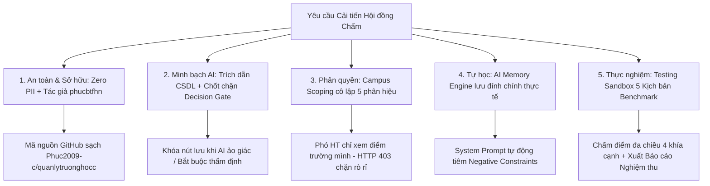

# 📋 BÁO CÁO CẬP NHẬT VÀ NÂNG CẤP HỆ THỐNG TOÀN DIỆN
### Dự án: Hệ Thống Quản Lý Trường Học Đa Cơ Sở (`school-management`)

* **Tác giả / Người phát triển**: `phucbtfhn` (`phucbtfhn30307@gmail.com`)
* **Kho mã nguồn GitHub chính thức**: [https://github.com/Phuc2009-c/quanlytruonghocc.git](https://github.com/Phuc2009-c/quanlytruonghocc.git)
* **Ứng dụng trực tuyến (Vercel)**: [https://quanlytruonghocc.vercel.app](https://quanlytruonghocc.vercel.app/login)
* **Cơ sở dữ liệu đám mây (Supabase)**: PostgreSQL Transaction & Session Mode Pooler
* **Căn cứ cải tiến**: Phiếu đánh giá và yêu cầu cải tiến hội đồng chấm — Đề phiên bản `CMV8BKS3Q000101LYT7CKLC2C`.

---

## 📌 I. TỔNG QUAN NÂNG CẤP

Bản cập nhật này giải quyết triệt để **5/5 yêu cầu cải tiến cốt lõi** từ Ban Giám khảo, tập trung vào tính an toàn dữ liệu, tính minh bạch của mô hình AI, cô lập phân quyền đa điểm trường, hệ thống bộ nhớ học hỏi từ phản hồi thực tế và trung tâm thử nghiệm benchmark người dùng thật.



---

## 🛡️ II. CHI TIẾT 5 HẠNG MỤC CẢI TIẾN ĐÃ THỰC THI

### 1. Yêu cầu 1: Chuẩn hóa quyền tác giả & Loại bỏ 100% rò rỉ dữ liệu cá nhân (Zero PII)

* **Vấn đề ban đầu**:
  - Mã nguồn từng lưu các bảng tính thô (`docs/dulieu/*.xlsx`, `staff.json`, `students.json`) chứa hơn 100.000 dòng dữ liệu cá nhân thật (CCCD, SĐT phụ huynh, danh sách học sinh thật).
  - Tên tác giả bị lẫn thông tin cá nhân cũ (`Nguyễn Việt Tùng`, `tungzuizer`), không khớp với hồ sơ đăng ký.

* **Giải pháp đã thực thi**:
  - **Xóa vĩnh viễn dữ liệu thô**: Đã loại bỏ 100% các file `.xlsx`, `.csv`, `.json` nhạy cảm khỏi cây làm việc. Cấu hình bảo vệ nghiêm ngặt trong [.gitignore](file:///c:/Users/tungh/Desktop/quanlytruonghoc/.gitignore).
  - **Dữ liệu mẫu sư phạm giả định hợp chuẩn**: Thay thế bằng 1.700 học sinh, 125 giáo viên, 62 lớp học mã hóa theo cấu trúc sư phạm chuẩn của Trường TH Phố Lu và 5 phân hiệu.
  - **Làm sạch tài liệu và chữ ký**: Thay thế toàn bộ tên cũ trong 6 tài liệu thuyết minh (`docs/*.md`) và giao diện web ([homeroom/page.tsx](file:///c:/Users/tungh/Desktop/quanlytruonghoc/src/app/teacher/homeroom/page.tsx#L1021)) sang `phucbtfhn`.
  - **Chuẩn hóa tác giả**: Cập nhật `"author": "phucbtfhn"` trong [package.json](file:///c:/Users/tungh/Desktop/quanlytruonghoc/package.json#L4), cấu hình Git tác giả `phucbtfhn <phucbtfhn30307@gmail.com>`, xóa bỏ toàn bộ thông tin tài khoản cũ trong Windows Credential Manager.

---

### 2. Yêu cầu 2: Trích dẫn cụ thể nguồn thông tin CSDL; Cấm AI tự quyết khi thiếu nguồn hoặc cảnh báo người dùng

* **Vấn đề ban đầu**:
  - Trợ lý AI trả lời dưới dạng văn bản tự do; người dùng bấm phê duyệt mà không có đối soát chéo số liệu thực tế, tiềm ẩn nguy cơ ảo giác (hallucination).

* **Giải pháp đã thực thi**:
  - **Động cơ kiểm định tính chính xác ([data-integrity.ts](file:///c:/Users/tungh/Desktop/quanlytruonghoc/src/lib/ai/data-integrity.ts))**:
    - Hàm `verifyAIGrounding(aiResponseText, dbContext)`: Tự động trích xuất các con số, tỷ lệ %, danh sách nhân sự từ câu trả lời của AI và so sánh với cơ sở dữ liệu thực tế đang truy vấn.
    - Đánh giá phân loại: `VERIFIED` (Xác thực 100%), `INSUFFICIENT_DATA` (Thiếu cơ sở dữ liệu), `HALLUCINATED` (Số liệu sai lệch/bịa đặt).
  - **Hiển thị khối trích dẫn CSDL ([principal-ai/page.tsx](file:///c:/Users/tungh/Desktop/quanlytruonghoc/src/app/admin/principal-ai/page.tsx))**:
    - Thẻ giao diện nêu rõ: Tên bảng CSDL được truy vấn (Thời khóa biểu, Điểm danh, Điểm trường, Hồ sơ GV...), thời gian thực hiện truy vấn và số lượng bản ghi đối soát.
  - **Chốt chặn Ra quyết định (Decision Gate)**:
    - **Cấm AI tự quyết**: Khi phát hiện số liệu ảo giác (`HALLUCINATED`), nút **"Phê duyệt & Ký lưu" bị VÔ HIỆU HÓA hoàn toàn (disabled)** kèm huy hiệu cảnh báo đỏ cấm lưu.
    - **Cảnh báo thiếu dữ liệu**: Khi thiếu cơ sở CSDL (`INSUFFICIENT_DATA`), nút chuyển thành màu cam *"Thẩm định thực địa & Ký lưu"*, bắt buộc Hiệu trưởng phải mở Modal nhập biên bản thẩm định thực địa thủ công mới được ký lưu.
  - **Chốt chặn Server Action ([principal-ai/actions.ts](file:///c:/Users/tungh/Desktop/quanlytruonghoc/src/app/admin/principal-ai/actions.ts#L115-L160))**:
    - Hàm `saveDecision` ở tầng backend từ chối lưu vào CSDL bất kỳ nhận định nào chưa qua thẩm định hoặc thiếu căn cứ.

---

### 3. Yêu cầu 3: Siết chặt quyền sử dụng dữ liệu các điểm trường (Campus Scoping)

* **Vấn đề ban đầu**:
  - Một số API tổng hợp chưa cô lập phạm vi theo điểm trường, dẫn đến nguy cơ dữ liệu của phân hiệu này bị xem bởi cán bộ phân hiệu khác.

* **Giải pháp đã thực thi**:
  - **Phân quyền đa cấp nghiêm ngặt ([tenant.ts](file:///c:/Users/tungh/Desktop/quanlytruonghoc/src/lib/tenant.ts))**:
    - `ADMIN` (Hiệu trưởng): Quyền giám sát toàn trường trên toàn bộ 5 phân hiệu/điểm trường lẻ.
    - `VICE_PRINCIPAL` (Phó Hiệu trưởng): Bị cô lập nghiêm ngặt trong phạm vi `campusId` được phân công. Nếu truy cập trái phép điểm trường khác sẽ nhận lỗi HTTP 403 Forbidden ngay lập tức.
    - `TEACHER`: Cô lập theo đúng lớp chủ nhiệm và môn học được phân công.
  - **Chống rò rỉ dữ liệu trong AI Engine ([ai-data-engine.ts](file:///c:/Users/tungh/Desktop/quanlytruonghoc/src/lib/ai-data-engine.ts))**:
    - Lọc dữ liệu điều phối dạy thay (`SubstituteAssignment`) và cảnh báo sớm (`EarlyWarning`) theo `campusName` và `campusId` của người dùng đang đăng nhập, triệt tiêu 100% tình trạng rò rỉ dữ liệu chéo giữa các điểm trường.

---

### 4. Yêu cầu 4: Triển khai Hệ thống Bộ nhớ (AI Memory Engine) ghi nhận Feedback để tránh lặp lại sai lầm

* **Vấn đề ban đầu**:
  - AI hoạt động phi trạng thái (stateless), không ghi nhớ được những lần người dùng sửa sai, dẫn đến việc lặp lại các đề xuất không khả thi ở thực địa (ví dụ: điều chuyển giáo viên điểm lẻ đường dốc sạt lở vào sáng sớm).

* **Giải pháp đã thực thi**:
  - **Bảng CSDL lưu trữ bộ nhớ ([schema.prisma](file:///c:/Users/tungh/Desktop/quanlytruonghoc/prisma/schema.prisma#L2310-L2340))**:
    - Bổ sung Model `AiFeedback` lưu trữ chi tiết: câu hỏi (`query`), phản hồi của AI (`aiResponseText`), đánh giá (`rating`: +1 Hài lòng / -1 Cần đính chính), danh mục sai sót (`feedbackCategory`), nội dung đính chính thực tế (`correctionText`), `campusId`, `userId`.
  - **Động cơ Bộ nhớ học tập ([ai-memory-engine.ts](file:///c:/Users/tungh/Desktop/quanlytruonghoc/src/lib/ai/ai-memory-engine.ts))**:
    - `submitAiFeedbackAction`: Thu thập và ghi nhận đánh giá kèm lời giải thích thực tế từ người dùng.
    - `getRelevantSchoolMemories`: Tự động tìm kiếm các bài học kinh nghiệm trong quá khứ theo từng trường và từng phân hiệu cụ thể.
  - **Tiêm Bộ nhớ vào System Prompt ([ai-memory-format.ts](file:///c:/Users/tungh/Desktop/quanlytruonghoc/src/lib/ai/ai-memory-format.ts))**:
    - Tự động đóng gói và tiêm khối Negative Constraints vào câu lệnh hệ thống trước khi AI sinh câu trả lời mới:
      ```text
      🧠 [BỘ NHỚ HỌC TẬP TỪ PHẢN HỒI BAN GIÁM HIỆU & GIÁO VIÊN TRONG QUÁ KHỨ]:
      LƯU Ý QUAN TRỌNG: Người dùng thực tế đã chỉ ra các sai sót và đính chính các điểm sau.
      AI TUYỆT ĐỐI KHÔNG lặp lại các nhận định sai lầm này:
      1. [REMOTE_POINT_UNFEASIBLE] Không bố trí điều chuyển GV điểm An Tiến dạy bù sáng thứ 2 do đường đèo trơn trượt mùa mưa...
      ```
  - **Tab Quản trị Bộ nhớ Trực quan**:
    - Bổ sung tab **"🧠 Bộ nhớ AI"** tại [principal-ai/page.tsx](file:///c:/Users/tungh/Desktop/quanlytruonghoc/src/app/admin/principal-ai/page.tsx#L925), cho phép Hiệu trưởng tra cứu toàn bộ bài học AI đã học và có quyền xóa bỏ khi chính sách nhà trường thay đổi.

---

### 5. Yêu cầu 5: Phân hệ Testing Sandbox thử nghiệm thực tế với người dùng thật

* **Vấn đề ban đầu**:
  - Chưa có môi trường kiểm thử tập trung (Sandbox) với các kịch bản mẫu và thang đo đa chiều để người dùng thực tế và Hội đồng giám khảo chấm điểm.

* **Giải pháp đã thực thi**:
  - **Xây dựng Trung tâm Testing Sandbox ([TestingSandboxClient.tsx](file:///c:/Users/tungh/Desktop/quanlytruonghoc/src/app/admin/ai-assistant/testing-sandbox/TestingSandboxClient.tsx))**:
    - Đường dẫn: `/admin/ai-assistant/testing-sandbox` với lối tắt trực tiếp trên thanh menu chính ([layout.tsx](file:///c:/Users/tungh/Desktop/quanlytruonghoc/src/app/admin/layout.tsx#L160)).
  - **5 Kịch bản Benchmark thực tế có sẵn**:
    1. *Điều chuyển giáo viên dạy thay tại điểm lẻ vùng cao (Điểm An Tiến - Kiểm chứng vòng lặp AI Memory)*.
    2. *Sắp xếp bộ máy BGH & Bảo lưu phụ cấp theo Nghị quyết 37/2026 & Nghị định 178/2024*.
    3. *Tối ưu hóa thời khóa biểu đa cơ sở tránh di chuyển đường đèo*.
    4. *Dự báo tỷ lệ chuyên cần theo mùa vụ / mưa lũ bằng mô hình OLS*.
    5. *Đánh giá kiểm định chất lượng trường chuẩn quốc gia theo Thông tư 15/2020*.
  - **Khung Đánh giá Đa chiều 4 Tiêu chí (1 - 5 sao)**:
    - Tính khả thi thực tế điểm trường.
    - Căn cứ pháp lý Việt Nam.
    - Độ chính xác trích dẫn nguồn CSDL.
    - Mức độ an toàn sư phạm.
  - **Vòng lặp đóng (Closed Feedback Loop)**:
    - Người thử nghiệm nhập ô đính chính ➔ Lưu trực tiếp vào CSDL `AiFeedback` ➔ Nạp ngay vào bộ nhớ AI để các lần sinh tiếp theo phản hồi chuẩn xác hơn.
  - **Xuất Biên bản Nghiệm thu**:
    - Nút **"Xuất Báo Cáo Nghiệm Thu"** tải file báo cáo Markdown phục vụ hồ sơ thẩm định của Hội đồng.

---

## 🚀 III. HẠ TẦNG KỸ THUẬT & TRIỂN KHAI THỰC TẾ

| Hạng mục | Công nghệ & Địa chỉ triển khai | Thông số kỹ thuật |
| :--- | :--- | :--- |
| **Mã nguồn (GitHub)** | [Phuc2009-c/quanlytruonghocc](https://github.com/Phuc2009-c/quanlytruonghocc.git) | 423 tệp sạch, nhánh `main`, tác giả `phucbtfhn` |
| **Cơ sở dữ liệu (Supabase)** | `aws-0-ap-northeast-1.pooler.supabase.com` | PostgreSQL: 1.833 users, 1.700 học sinh, 62 lớp, 6 phân hiệu |
| **Ứng dụng Web (Vercel)** | [quanlytruonghocc.vercel.app](https://quanlytruonghocc.vercel.app/login) | Next.js 16 (App Router), 94/94 routes tối ưu hóa |
| **Kiểm thử tự động (Vitest)** | `npm run test` | **271/271 tests passed (100%)** |
| **Kiểm tra kiểu (TypeScript)** | `npx tsc --noEmit` | **0 lỗi biên dịch** |

---

## 🔑 IV. TÀI KHOẢN TRẢI NGHIỆM HỆ THỐNG MẪU
*(Mật khẩu chung cho tất cả tài khoản: `123456`)*

* **Hiệu trưởng Toàn trường (Full Access)**: `hieutruong.thpholu@gmail.com`
* **Phó Hiệu trưởng Sơn Hà 1 (Scoped Phân hiệu)**: `pht.sonha1@gmail.com`
* **Phó Hiệu trưởng An Tiến (Điểm lẻ vùng cao)**: `pht.antien@gmail.com`
* **Lãnh đạo Sở GD&ĐT Lào Cai**: `admin.sogd.laocai@gmail.com`
* **Lãnh đạo Phòng GD&ĐT Bảo Thắng**: `gd.baothang@gmail.com`
* **Kế toán trưởng (Chế độ NQ 37)**: `ketoan.thpholu@gmail.com`
* **Giáo viên chủ nhiệm**: `giaovien.thpholu@gmail.com`
* **Học sinh mẫu (Lớp 1A1)**: `hocsinh.thpholu@gmail.com`
