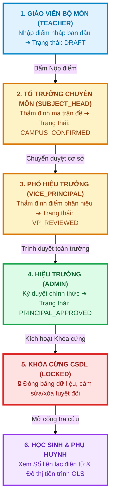
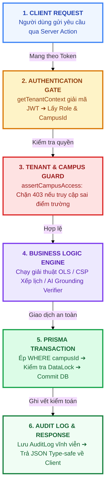
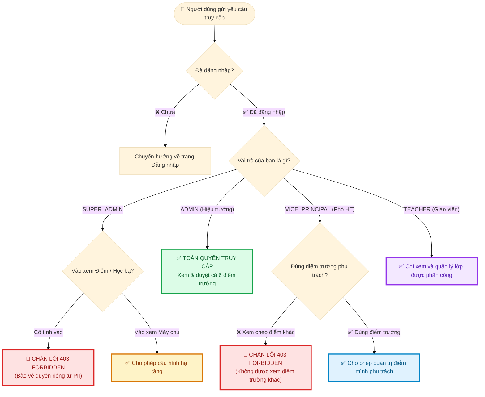
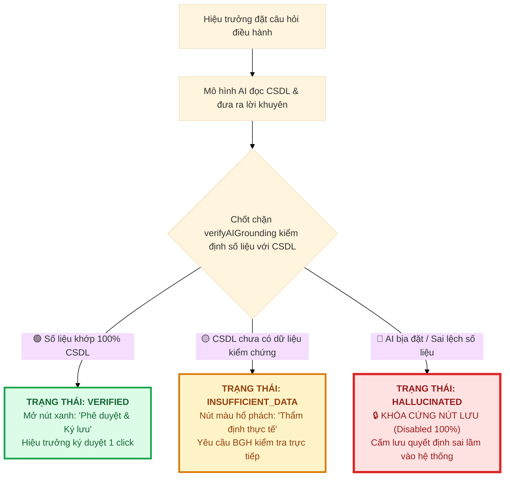

# 🌟 BẢN THUYẾT MINH DỰ ÁN: WORKFLOW VẬN HÀNH, LOGIC KỸ THUẬT & TRIẾT LÝ VIBE CODING VỚI AI
### Hệ Thống Quản Lý Trường Học Đa Cơ Sở & Trợ Lý Quản Trị Chiến Lược AI
* **Tác giả / Lập trình viên**: `phucbtfhn` (`phucbtfhn30307@gmail.com`)
* **Mã đề thi thực chứng**: `CMV8BKS3Q000101LYT7CKLC2C`
* **Kho mã nguồn GitHub**: [https://github.com/Phuc2009-c/quanlytruonghocc.git](https://github.com/Phuc2009-c/quanlytruonghocc.git)
* **Website triển khai thực tế**: [https://quanlytruonghocc.vercel.app](https://quanlytruonghocc.vercel.app/login)
* **Cơ sở dữ liệu Đám mây**: Supabase PostgreSQL Cloud (Tokyo Region - `aws-0-ap-northeast-1`)
* **Bộ khung công nghệ**: Next.js 16 (App Router), TypeScript, Prisma ORM, Tailwind CSS / Vanilla CSS, Vitest, Google Gemini AI.

---

## 📌 MỤC LỤC
1. [Triết lý "Vibe Coding với AI" Đỉnh Cao Của Dự Án](#1-triết-lý-vibe-coding-với-ai-đỉnh-cao-của-dự-án)
2. [Mô Tả Tổng Quan Dự Án & Bài Toán Thực Tiễn](#2-mô-tả-tổng-quan-dự-án--bài-toán-thực-tiễn)
3. [Hệ Thống Tài Khoản, Phân Quyền 8 Cấp & Luồng Tương Tác Quản Trị](#3-hệ-thống-tài-khoản-phân-quyền-8-cấp--luồng-tương-tác-quản-trị)
4. [Logic Flow: Luồng Logic Kỹ Thuật & Kiến Trúc AI Chuyên Sâu](#4-logic-flow-luồng-logic-kỹ-thuật--kiến-trúc-ai-chuyên-sâu)
5. [Số Liệu Kiểm Chứng & Năng Lực Triển Khai Thực Tế](#5-số-liệu-kiểm-chứng--năng-lực-triển-khai-thực-tế)
6. [Bộ Câu Hỏi Vấn Đáp Chuyên Sâu Về AI & Vibe Coding Cho Giám Khảo](#6-bộ-câu-hỏi-vấn-đáp-chuyên-sâu-về-ai--vibe-coding-cho-giám-khảo)
7. [Kịch Bản Thuyết Trình Pitching 3 Phút Mẫu](#7-kịch-bản-thuyết-trình-pitching-3-phút-mẫu)

---

## 1. TRIẾT LÝ "VIBE CODING VỚI AI" ĐỈNH CAO CỦA DỰ ÁN

### 🎯 Sự khác biệt giữa "Vibe Coding sơ cấp" và "Vibe Coding thực thụ"
Trong cuộc thi này, ban giám khảo tìm kiếm những dự án thể hiện sự kết hợp hoàn hảo giữa **trí tuệ con người** và **năng lực bứt phá của AI**:

```
┌───────────────────────────────────────────────────────────────────────────┐
│                          MÔ HÌNH VIBE CODING AGENTIC                      │
├─────────────────────────────────────┬─────────────────────────────────────┤
│      VAI TRÒ CON NGƯỜI (ARCHITECT)  │          VAI TRÒ CỦA AI (ENGINE)    │
├─────────────────────────────────────┼─────────────────────────────────────┤
│ 1. Thấu cảm bài toán giáo dục đặc thù│ 1. Tốc độ sinh mã nguồn siêu tốc     │
│ 2. Thiết kế cấu trúc CSDL 82 bảng   │ 2. Xây dựng 94 màn hình Next.js 16  │
│ 3. Thiết lập chốt chặn an toàn AI    │ 3. Viết 271 Unit Test tự động       │
│ 4. Quy chuẩn pháp lý (NQ37, NĐ178)  │ 4. Rà soát lỗi Type-safe tuyệt đối  │
│ 5. Đánh giá chất lượng thực tế      │ 5. Triển khai CI/CD Vercel & Supabase│
└─────────────────────────────────────┴─────────────────────────────────────┘
```

* **Vibe Coding không phải là viết code hời hợt**: Dự án không dùng AI để sinh ra một con chatbot đơn giản hay vài trang web mẫu tĩnh. 
* **Vibe Coding là Tối ưu hóa Sức mạnh Đôi bên (Human-AI Symbiosis)**:
  - **Lập trình viên làm chủ kiến trúc**: Đặt ra các nguyên tắc cốt lõi: *"Không bao giờ để LLM tính toán những gì Toán học làm tốt hơn"*, *"Mọi số liệu AI nói ra đều phải bị kiểm định chéo với CSDL thật"*, *"Dữ liệu các điểm trường vùng cao phải được cô lập tuyệt đối"*.
  - **AI làm đối tác kỹ thuật thực thi**: AI hiện thực hóa các yêu cầu phức tạp trong thời gian kỷ lục: từ bộ giải thuật hồi quy tuyến tính OLS, ma trận khoảng cách km điều chuyển dạy thay, cho đến cơ chế đồng bộ Offline-First PWA.

---

## 2. MÔ TẢ TỔNG QUAN DỰ ÁN & BÀI TOÁN THỰC TIỄN

### 🏫 Bối cảnh thực tế: Trường phổ thông đa cơ sở / điểm trường lẻ vùng cao
Các phần mềm quản lý trường học hiện nay (như vnEdu, SMAS) được thiết kế cho mô hình **trường đơn lẻ, cơ sở vật chất tập trung tại đồng bằng**. Khi áp dụng vào mô hình trường học vùng cao:
* **Địa bàn chia cắt, phân tán**: Ví dụ điển hình là **Trường Phổ thông Dân tộc Bán trú TH Phố Lu (Lào Cai)** gồm **1 trường chính (Trung tâm)** và **5 điểm trường lẻ** (Sơn Hà 1, Sơn Hà 2, Sơn Hải, Cốc Xâm, An Tiến) cách xa từ **3.5 km đến 8.5 km đường đèo dốc hiểm trở**.
* **Đứt gãy thông tin quản trị**: Ban Giám hiệu ở trường chính không thể biết ngay trong sáng nay điểm An Tiến có bao nhiêu học sinh nghỉ học, giáo viên có lên lớp đúng giờ không, hay đường sạt lở cần bố trí ai dạy thay.
* **Gánh nặng hành chính & Báo cáo thủ công**: Hàng tuần, các điểm lẻ phải gửi báo cáo giấy hoặc nhắn tin qua Zalo phân tán, dẫn đến việc xử lý dữ liệu chậm trễ, không có khả năng cảnh báo sớm nguy cơ học sinh bỏ học hoặc sa sút học lực.

### 💡 Giải pháp đột phá của Dự án
Dự án kiến tạo một **Hệ điều hành quản trị trường học liên cấp thông minh (School Management OS)**, tích hợp **Trợ lý AI Chiến lược cho Ban Giám Hiệu** với 3 trụ cột:
1. **Thu thập dữ liệu 3 pha thời gian thực (Sáng - Trưa - Tối)** từ mọi điểm trường về bảng điều khiển trung tâm.
2. **Cơ chế Phân quyền & Cô lập đa điểm trường (Campus Scoping)**: Đảm bảo Phó Hiệu trưởng điểm lẻ quản lý đúng cơ sở của mình, trong khi Hiệu trưởng nắm bức tranh tổng thể toàn trường.
3. **Trợ lý AI An toàn & Đáng tin cậy**: Tích hợp chốt chặn đối soát số liệu (Grounding Gate) chống ảo giác, kết hợp thuật toán Hồi quy Tuyến tính OLS để phân tích xu hướng học sinh và thuật toán phân công dạy thay theo khoảng cách địa lý.

---

## 3. HỆ THỐNG TÀI KHOẢN, PHÂN QUYỀN 8 CẤP & LUỒNG TƯƠNG TÁC QUẢN TRỊ

Hệ thống quản lý trường học liên cấp đa phân hiệu vận hành dựa trên mô hình **Phân quyền Đa tầng (Multi-tier Role-Based Access Control - RBAC)** kết hợp **Cô lập Điểm trường (Campus Scoping)**. Dưới đây là phân tích toàn diện về cấu trúc tài khoản, luồng tương tác qua lại và cơ chế quản lý an ninh:

---

### 👥 3.1. Bảng Ma Trận 8 Vai Trò Tài Khoản (Roles & Permissions Matrix)

```
┌──────────────────────────────────────────────────────────────────────────────────────────────────┐
│                                 SƠ ĐỒ PHÂN CẤP TÀI KHOẢN HỆ THỐNG                                │
├──────────────────────────────────────────────────────────────────────────────────────────────────┤
│ [CẤP BỘ / HẠ TẦNG]   ➔ SUPER_ADMIN (Quản trị hạ tầng máy chủ, CẤM xem học bạ chi tiết)           │
│ [CẤP TỈNH / SỞ]      ➔ DEPARTMENT_ADMIN (Sở GD&ĐT: Xem thống kê toàn tỉnh theo departmentId)     │
│ [CẤP HUYỆN / PHÒNG]  ➔ DISTRICT_ADMIN (Phòng GD&ĐT: Xem thống kê huyện theo districtWardId)      │
│ [CẤP XÃ / ĐỊA PHƯƠNG]➔ WARD_ADMIN (UBND Xã: Xem phổ cập giáo dục & bán trú theo CampusWardMap)   │
│                                           │                                                      │
│ [CẤP TRƯỜNG TOÀN CỤC]➔ ADMIN (Hiệu trưởng / Kế toán: Toàn quyền cả 6 điểm trường, ký duyệt AI)  │
│                                           │                                                      │
│ [CẤP PHÂN HIỆU ĐIỂM LẺ]➔ VICE_PRINCIPAL (Phó Hiệu trưởng: Khóa chặt với campusId, cấm xem chéo)  │
│ [CẤP TỔ CHUYÊN MÔN]  ➔ SUBJECT_HEAD (Tổ trưởng: Quản lý chuyên môn tổ bộ môn xuyên phân hiệu)    │
│ [CẤP LỚP HỌC]        ➔ TEACHER (Giáo viên bộ môn & GVCN: Điểm danh, nhập điểm, báo ốm)           │
│ [CẤP NGƯỜI THỤ HƯỞNG]➔ STUDENT / PARENT (Học sinh & Phụ huynh: Tra cứu học bạ, chuyên cần)       │
└──────────────────────────────────────────────────────────────────────────────────────────────────┘
```

| Vai Trò (`Role`) | Phạm Vi (`ScopeType`) | Quyền Hạn Nghiệp Vụ Cốt Lõi | Cơ Chế Bảo Vệ / Giới Hạn |
| :--- | :--- | :--- | :--- |
| **`SUPER_ADMIN`** | `GLOBAL` | Quản trị hạ tầng đám mây, cấu hình hệ thống, sao lưu CSDL | **Chặn xem học bạ/điểm số chi tiết (HTTP 403)** để bảo vệ PII |
| **`DEPARTMENT_ADMIN`** | `DEPARTMENT` | Giám sát vĩ mô toàn tỉnh, duyệt chỉ tiêu tuyển sinh | Chỉ xem dữ liệu tổng hợp của các trường thuộc Sở (`departmentId`) |
| **`DISTRICT_ADMIN`** | `DISTRICT` | Giám sát chất lượng các trường trong huyện, thanh tra KPI | Chỉ xem dữ liệu các trường thuộc Phòng GD&ĐT (`districtWardId`) |
| **`WARD_ADMIN`** | `WARD` | Giám sát tình hình phổ cập giáo dục, học sinh bán trú | Chỉ xem các điểm trường đóng trên địa bàn xã (`CampusWardMap`) |
| **`ADMIN`** (Hiệu trưởng) | `SCHOOL_GLOBAL` | Toàn quyền điều hành cả 6 phân hiệu, phê duyệt AI, khóa sổ 6 cấp | Duy nhất có quyền ký số quyết định AI và duyệt mở khóa dữ liệu |
| **`VICE_PRINCIPAL`** (Phó HT) | `CAMPUS` | Quản lý học vụ, điểm danh, nề nếp tại phân hiệu phụ trách | **Bị khóa cứng theo `campusId`** (truy cập điểm khác bị chặn 403) |
| **`SUBJECT_HEAD`** (Tổ trưởng) | `SUBJECT_GROUP` | Duyệt kế hoạch bài dạy, duyệt điểm kiểm tra của tổ | Giới hạn trong tổ bộ môn được phân công (`UserRoleScope`) |
| **`TEACHER`** (Giáo viên) | `CLASS_SUBJECT` | Điểm danh học sinh, nhập điểm, ghi sổ đầu bài, báo vắng | Chỉ sửa được lớp mình dạy; bị khóa sửa khi dữ liệu chuyển `LOCKED` |
| **`STUDENT`** / **`PARENT`** | `INDIVIDUAL` | Xem thời khóa biểu cá nhân, tra cứu điểm, theo dõi chuyên cần | Chỉ xem được thông tin của chính bản thân/con em mình |

---

### 🔄 3.2. Sơ Đồ Trực Quan: Luồng Vận Hành Của Các Tài Khoản (Đơn Giản & Dễ Nhìn)

Nhằm giúp Ban Giám khảo nắm bắt toàn bộ hệ thống trong 10 giây, luồng tương tác giữa các tài khoản được tinh gọn thành **3 sơ đồ tuyến tính trực quan, phân màu rõ ràng**:

---

#### 📌 SƠ ĐỒ 1: QUY TRÌNH HỌC VỤ & KHÓA SỔ HỌC BẠ 6 CẤP (CHỮ TO RÕ RÀNG)
*(Dữ liệu đi tuần tự qua 6 chốt chặn - Đóng băng CSDL chống sửa điểm)*

```
┌──────────────────────────────────────────────────────────────────────────────┐
│  👨‍🏫 BƯỚC 1: GIÁO VIÊN BỘ MÔN (TEACHER)                                       │
│  • Nhập điểm kiểm tra thang 10 vào sổ điểm điện tử                          │
│  • Trạng thái CSDL: [ DRAFT ] (Giáo viên còn quyền sửa)                      │
└──────────────────────────────────────┬───────────────────────────────────────┘
                                       │ Bấm "Nộp bảng điểm"
                                       ▼
┌──────────────────────────────────────────────────────────────────────────────┐
│  🧑‍🏫 BƯỚC 2: TỔ TRƯỞNG CHUYÊN MÔN (SUBJECT_HEAD)                              │
│  • Rà soát ma trận đề thi, kiểm tra phổ điểm đúng tiến độ                    │
│  • Bấm duyệt ➔ Trạng thái CSDL: [ CAMPUS_CONFIRMED ]                         │
└──────────────────────────────────────┬───────────────────────────────────────┘
                                       │ Chuyển lên Phó Hiệu trưởng
                                       ▼
┌──────────────────────────────────────────────────────────────────────────────┐
│  👔 BƯỚC 3: PHÓ HIỆU TRƯỞNG PHÂN HIỆU (VICE_PRINCIPAL)                       │
│  • Thẩm định học vụ điểm lẻ (Khóa chặt theo campusId)                       │
│  • Bấm duyệt ➔ Trạng thái CSDL: [ VP_REVIEWED ]                              │
└──────────────────────────────────────┬───────────────────────────────────────┘
                                       │ Trình Hiệu trưởng phê duyệt
                                       ▼
┌──────────────────────────────────────────────────────────────────────────────┐
│  🎓 BƯỚC 4: HIỆU TRƯỞNG NHÀ TRƯỜNG (ADMIN)                                   │
│  • Ký duyệt toàn trường ➔ Trạng thái CSDL: [ PRINCIPAL_APPROVED ]            │
│  • Kích hoạt tự động hàm lockDataRecord()                                    │
└──────────────────────────────────────┬───────────────────────────────────────┘
                                       │ ĐÓNG BĂNG VĨNH VIỄN CSDL
                                       ▼
┌──────────────────────────────────────────────────────────────────────────────┐
│  🔒 BƯỚC 5: KHÓA CỨNG DỮ LIỆU (LOCKED)                                       │
│  • Cấm tuyệt đối lệnh UPDATE / DELETE trong PostgreSQL                       │
│  • Muốn sửa điểm phải làm Phiếu giải trình (Unlock Request) và ghi AuditLog  │
└──────────────────────────────────────┬───────────────────────────────────────┘
                                       │ Công bố dữ liệu chính thức
                                       ▼
┌──────────────────────────────────────────────────────────────────────────────┐
│  👨‍👩‍👧 BƯỚC 6: HỌC SINH & PHỤ HUYNH (STUDENT / PARENT)                         │
│  • Tra cứu Sổ liên lạc điện tử chính thức                                    │
│  • Xem đồ thị phân tích tiến trình học tập OLS (Tiến bộ / Sa sút)            │
└──────────────────────────────────────────────────────────────────────────────┘
```



---

#### 📌 SƠ ĐỒ 2: LUỒNG BÁO NGHỈ & ĐIỀU CHUYỂN DẠY THAY TỨC THÌ (AI DISPATCH)

```
┌──────────────────────────────────────────────────────────────────────────────┐
│  👨‍🏫 1. GIÁO VIÊN BÁO NGHỈ ĐỘT XUẤT                                          │
│  07:00 sáng: Bị sạt lở đường đèo ➔ Bấm "Báo nghỉ" tiết 2 môn Toán            │
└──────────────────────────────────────┬───────────────────────────────────────┘
                                       │ Gửi sự kiện khẩn cấp
                                       ▼
┌──────────────────────────────────────────────────────────────────────────────┐
│  🤖 2. ĐỘNG CƠ AI & MA TRẬN KHOẢNG CÁCH KM                                   │
│  • Lọc giáo viên cùng môn Toán có tiết trống                                 │
│  • Tối ưu km: Trung tâm ➔ Sơn Hà 1 (3.5 km đường ngắn nhất)                  │
└──────────────────────────────────────┬───────────────────────────────────────┘
                                       │ Đề xuất phương án tối ưu
                                       ▼
┌──────────────────────────────────────────────────────────────────────────────┐
│  👔 3. PHÓ HIỆU TRƯỞNG & HIỆU TRƯỞNG PHÊ DUYỆT                               │
│  • Xem đề xuất của AI ➔ Bấm Duyệt chỉ trong 1 click trên Dashboard           │
└──────────────────────────────────────┬───────────────────────────────────────┘
                                       │ Tự động kích hoạt 2 hành động
                                       ├───────────────────────────────────────┐
                                       ▼                                       ▼
┌──────────────────────────────────────────────┐ ┌─────────────────────────────┐
│  📅 4. THỜI KHÓA BIỂU ĐIỆN TỬ                │ │ 📲 5. GIÁO VIÊN DẠY THAY    │
│  Tự động đổi tên giáo viên trên hệ thống     │ │ Nhận thông báo SMS & App    │
│  Học sinh và nhà trường theo dõi thời gian   │ │ Kịp thời lên lớp đúng giờ   │
└──────────────────────────────────────────────┘ └─────────────────────────────┘
```

### 📋 3.2. BÓC TÁCH CHI TIẾT LOGIC HOẠT ĐỘNG CỦA TỪNG VAI TRÒ TÀI KHOẢN

Dưới đây là bảng phân tích kỹ thuật chi tiết về **Dữ liệu Đầu vào (Inputs) ➔ Thuật toán Xử lý (Processing Logic) ➔ Kết quả Đầu ra & Chốt chặn Bảo mật (Outputs & Guardrails)** của từng loại tài khoản:

#### 1. Tài Khoản Giáo Viên (`TEACHER` / `HOMEROOM_TEACHER`)
* **Màn hình sử dụng**: Mobile Web / Tablet tại `/teacher/attendance`, `/teacher/gradebook`, `/teacher/substitute`.
* **Logic Điểm danh**:
  - Dữ liệu đầu vào: Danh sách học sinh của lớp phụ trách (`classId`).
  - Xử lý: Hỗ trợ lưu tạm thời vào `IndexedDB / LocalStorage` khi mất kết nối mạng. Tự động đồng bộ ngầm (Background Sync) lên CSDL Supabase khi có sóng 4G/Wifi.
  - Chốt chặn: Sau **07:30 sáng**, bản ghi điểm danh tự động khóa sửa; mọi điều chỉnh bổ sung phải có sự đồng ý của Phó Hiệu trưởng.
* **Logic Nhập Điểm**:
  - Nhập điểm kiểm tra thang 10 (`ORAL`, `FIFTEEN_MIN`, `MIDTERM`, `FINAL`).
  - Trạng thái ban đầu: `DRAFT` (Giáo viên tự do sửa đổi).
  - Khi bấm **"Nộp bảng điểm"**: Chuyển trạng thái sang `SUBMITTED`, giáo viên mất quyền sửa đổi trực tiếp.
  - Khi bản ghi chuyển sang `LOCKED`: Bị khóa cứng hoàn toàn.
* **Logic Trợ Lý Nhận Xét Học Bạ AI**:
  - Giáo viên bấm "Gợi ý nhận xét": Hệ thống gửi điểm số và chỉ số chuyên cần sang Gemini API.
  - Prompt được gài sẵn khung chuẩn mực theo **Thông tư 22/2021/TT-BGDĐT** (câu từ động viên, khích lệ, bảo đảm an toàn tâm lý học sinh). Giáo viên xem xét, biên tập lại trước khi lưu.

---

#### 2. Tài Khoản Tổ Trưởng Chuyên Môn (`SUBJECT_HEAD`)
* **Màn hình sử dụng**: `/admin/academic/subject-review`.
* **Logic Thẩm định Cấp Tổ**:
  - Hệ thống gọi hàm `assertSubjectGroupAccess()`: Tổ trưởng môn Toán chỉ được thẩm định các giáo viên thuộc tổ Toán, không thể can thiệp sang tổ Ngữ văn hay Tiếng Anh.
  - Kiểm tra ma trận đề thi và phổ điểm của các lớp trong tổ.
  - Hành động: Bấm **"Ký xác nhận chuyên môn"** ➔ CSDL cập nhật trạng thái từ `SUBMITTED` sang `CAMPUS_CONFIRMED`.

---

#### 3. Tài Khoản Phó Hiệu Trưởng Phân Hiệu (`VICE_PRINCIPAL`)
* **Màn hình sử dụng**: `/admin/campus-dashboard`, `/admin/attendance-monitor`.
* **Logic Cô Lập Phân Hiệu (Campus Scoping Guard)**:
  - Tài khoản bị gán cố định với `campusId` (ví dụ `cmp_sonha1` cho điểm Sơn Hà 1).
  - Mọi thao tác truy vấn CSDL đều bị ép điều kiện: `where: { campusId: ctx.campusId }`.
  - **Chốt chặn an toàn**: Nếu Phó HT Sơn Hà 1 cố tình truy cập vào URL của điểm An Tiến, hàm `assertCampusAccess()` lập tức ném lỗi **HTTP 403 Forbidden**.
* **Logic Thẩm Định Chuyên Cần & Nguy Cơ Bỏ Học**:
  - Hệ thống tự động gắn cờ đỏ cảnh báo học sinh vắng từ 3 buổi liên tiếp không phép (nguy cơ bỏ học vào mùa gặt hoặc sương muối).
  - Phó Hiệu trưởng giao việc trực tiếp cho GVCN lớp phải đến tận nhà học sinh vận động.
* **Logic Ký Duyệt Học Vụ Cấp Cơ Sở**:
  - Rà soát toàn bộ điểm số của các lớp thuộc phân hiệu ➔ Ký duyệt chuyển trạng thái từ `CAMPUS_CONFIRMED` sang `VP_REVIEWED`.

---

#### 4. Tài Khoản Hiệu Trưởng (`ADMIN`)
* **Màn hình sử dụng**: `/admin/dashboard`, `/admin/principal-ai`, `/admin/daily-summary`, `/admin/data-lock`.
* **Logic Điều Hành Toàn Cục (Global Executive)**:
  - Cờ `isPrincipal = true`: Nhận dữ liệu tổng hợp của toàn bộ 6 phân hiệu.
  - Xem Dashboard 3 pha thời gian thực: Tỷ lệ chuyên cần toàn trường, danh sách giáo viên vắng, sự cố cơ sở vật chất.
* **Logic Trợ Lý AI Chiến Lược & Decision Gate**:
  - Đặt câu hỏi điều hành ➔ AI phân tích CSDL và đưa ra đề xuất.
  - Hàm `verifyAIGrounding()` đối soát chéo số liệu AI với Supabase:
    - Nếu khớp: Mở nút **"Phê duyệt & Ký lưu"** (Xanh lá).
    - Nếu AI bịa số liệu: **Khóa cứng nút lưu (Disabled 100%)**, ngăn chặn quyết định sai lầm.
* **Logic Khóa Sổ & Mở Khóa Dữ Liệu**:
  - Bấm ký duyệt toàn trường: Kích hoạt hàm `lockDataRecord()`, chuyển trạng thái sang `LOCKED`.
  - Khi có đơn phúc khảo: Hiệu trưởng duyệt **Unlock Request** ➔ Mở khóa cho giáo viên sửa lại điểm ➔ Hệ thống ghi vết vĩnh viễn vào `AuditLog`.

---

#### 5. Tài Khoản Kế Toán & Quản Trị Nhân Sự (`STAFF` / `ACCOUNTANT`)
* **Màn hình sử dụng**: `/admin/policy-engine`, `/admin/finance`.
* **Logic Tính Phụ Cấp Bảo Lưu Dôi Dư Theo Nghị Định 178/2024 & NĐ 67/2025**:
  - Dữ liệu đầu vào: Danh sách cán bộ lãnh đạo chuyển đổi vị trí sau sáp nhập trường theo Nghị quyết 37/2026/NQ-CP.
  - Thuật toán xử lý: Tự động tính chênh lệch phụ cấp lãnh đạo $\Delta P = P_{\text{cũ}} - P_{\text{mới}}$.
  - Thiết lập đồng hồ đếm ngược bảo lưu **đúng 36 tháng**, tự động xuất bảng dự toán ngân sách chi trả hàng tháng cho Kế toán trình Kho bạc Nhà nước.

---

#### 6. Tài Khoản Học Sinh & Phụ Huynh (`STUDENT` / `PARENT`)
* **Màn hình sử dụng**: `/student/portal`, `/student/gradebook`.
* **Logic Tra Cứu Bảo Mật**:
  - Học sinh chỉ xem được dữ liệu của chính mình (`where: { studentId: ctx.userId }`).
  - **Điều kiện hiển thị điểm**: Bảng điểm chỉ mở cho học sinh tra cứu khi bản ghi đã đạt trạng thái `LOCKED` (đã qua đủ 5 vòng duyệt). Khi điểm còn ở dạng `DRAFT` hoặc `SUBMITTED`, hệ thống hiển thị thông báo: *"Bảng điểm đang trong quy trình thẩm định chuyên môn"*.
  - Xem đồ thị tiến trình học tập OLS ($y = ax + b$) để biết mình đang ở quỹ đạo Tiến bộ, Sa sút hay Dao động.

---

#### 7. Tài Khoản Quản Lý Nhà Nước (`DEPARTMENT_ADMIN`, `DISTRICT_ADMIN`, `WARD_ADMIN`)
* **Màn hình sử dụng**: `/department/dashboard`, `/district/dashboard`, `/ward/dashboard`.
* **Logic Giám Sát Vĩ Mô (Read-Only Aggregate Scope)**:
  - Toàn bộ là quyền Đọc (Read-only), không có quyền can thiệp vào quy trình học vụ của nhà trường.
  - **Sở GD&ĐT (`DEPARTMENT_ADMIN`)**: Tự động lọc các trường thuộc `departmentId` phụ trách.
  - **Phòng GD&ĐT (`DISTRICT_ADMIN`)**: Tự động lọc các trường thuộc `districtWardId` phụ trách.
  - **UBND Xã (`WARD_ADMIN`)**: Hàm `getWardAllowedCampusIds()` truy vấn bảng quan hệ địa lý `CampusWardMap` để hiển thị thống kê học sinh của các điểm trường đóng trên địa bàn xã.

---

#### 📌 SƠ ĐỒ 3: VÒNG ĐỜI XỬ LÝ YÊU CẦU DỮ LIỆU TỪ CLIENT ĐẾN CSDL (REQUEST LIFECYCLE & PIPELINE)
*(Luồng logic kỹ thuật 6 bước khi một tài khoản gọi Server Action hoặc API)*

```
┌──────────────────────────────────────────────────────────────────────────────┐
│  🖥️ BƯỚC 1: CLIENT GỬI YÊU CẦU (CALL SERVER ACTION / API)                    │
│  Tài khoản thực hiện thao tác (Nhập điểm, Xem báo cáo, Duyệt AI...)          │
└──────────────────────────────────────┬───────────────────────────────────────┘
                                       │ Gửi kèm Cookie Session JWT
                                       ▼
┌──────────────────────────────────────────────────────────────────────────────┐
│  🔑 BƯỚC 2: XÁC THỰC DANH TÍNH (AUTHENTICATION GATE)                         │
│  • Hàm getTenantContext() giải mã Token JWT                                  │
│  • Trích xuất: userId, role, schoolId, campusId, isApproved                  │
│  • Nếu chưa đăng nhập / Token hết hạn ➔ Ném lỗi 401 Unauthorized             │
└──────────────────────────────────────┬───────────────────────────────────────┘
                                       │ Session hợp lệ
                                       ▼
┌──────────────────────────────────────────────────────────────────────────────┐
│  🛡️ BƯỚC 3: KIỂM SOÁT PHÂN QUYỀN & CÔ LẬP ĐIỂM TRƯỜNG (TENANT & CAMPUS SCOPE)│
│  • isApproved === false ➔ Ép schoolId rỗng (unapproved-no-access-000)        │
│  • VICE_PRINCIPAL ➔ Kiểm tra targetCampusId === session.campusId             │
│    (Nếu cố tình xem điểm trường khác ➔ Ném lỗi HTTP 403 Forbidden)           │
│  • SUPER_ADMIN ➔ Chặn truy cập Học bạ/Điểm số chi tiết (assertNotSuperAdmin) │
└──────────────────────────────────────┬───────────────────────────────────────┘
                                       │ Vượt qua chốt chặn phân quyền
                                       ▼
┌──────────────────────────────────────────────────────────────────────────────┐
│  ⚙️ BƯỚC 4: THỰC THI THUẬT TOÁN NGHIỆP VỤ (BUSINESS LOGIC ENGINE)            │
│  • Tính toán tiến trình học sinh: Chạy thuật toán Hồi quy OLS (0.02ms)       │
│  • Xếp lịch dạy thay: Chạy thuật toán Quy hoạch ràng buộc CSP & Ma trận Km   │
│  • Tư vấn AI: Chạy verifyAIGrounding() đối soát số liệu chống ảo giác        │
└──────────────────────────────────────┬───────────────────────────────────────┘
                                       │ Thực thi lệnh CSDL
                                       ▼
┌──────────────────────────────────────────────────────────────────────────────┐
│  🗄️ BƯỚC 5: GIAO DỊCH CƠ SỞ DỮ LIỆU (PRISMA TRANSACTION & ROW LEVEL FILTER) │
│  • Ép bộ lọc WHERE campusId / schoolId vào câu lệnh SQL                      │
│  • Kiểm tra trạng thái Khóa (DataLock): Nếu LOCKED ➔ Từ chối UPDATE/DELETE   │
│  • Commit giao dịch xuống CSDL Supabase PostgreSQL Cloud                     │
└──────────────────────────────────────┬───────────────────────────────────────┘
                                       │ Ghi vết kiểm toán tự động
                                       ▼
┌──────────────────────────────────────────────────────────────────────────────┐
│  📜 BƯỚC 6: NHẬT KÝ KIỂM TOÁN & PHẢN HỒI CLIENT (AUDIT LOG & RESPONSE)       │
│  • Tự động ghi vết vĩnh viễn vào bảng AuditLog: User, IP, Timestamp, Diff   │
│  • Trả về kết quả Type-Safe JSON an toàn cho Client hiển thị                 │
└──────────────────────────────────────────────────────────────────────────────┘
```



---

### 🔐 3.3. Sơ Đồ Bảo Mật: Cô Lập Tài Khoản & Phân Quyền Điểm Trường

```
┌──────────────────────────────────────────────────────────────────────────────┐
│                     👤 NGƯỜI DÙNG GỬI YÊU CẦU TRUY CẬP                       │
└──────────────────────────────────────┬───────────────────────────────────────┘
                                       │ NextAuth giải mã Token JWT
                                       ▼
                     ┌───────────────────────────────────┐
                     │ Kiểm tra Vai trò (Role Scoping)   │
                     └─────────────────┬─────────────────┘
         ┌─────────────────────────────┼─────────────────────────────┐
         ▼                             ▼                             ▼
┌─────────────────────────┐ ┌─────────────────────────┐ ┌─────────────────────┐
│  SUPER_ADMIN            │ │  VICE_PRINCIPAL         │ │  ADMIN (Hiệu trưởng)│
│  (Quản trị viên máy chủ)│ │  (Phó HT Phân hiệu)     │ │  (Toàn quyền)       │
│  • Xem cấu hình hạ tầng │ │  • Chỉ xem điểm mình    │ │  • Xem & duyệt cả   │
│  • CẤM XEM HỌC BẠ PII   │ │  • CỐ XEM ĐIỂM KHÁC:    │ │    6 điểm trường    │
│    ➔ Chặn 403 Forbidden │ │    ➔ Chặn 403 Forbidden │ │  • Ký duyệt AI      │
└─────────────────────────┘ └─────────────────────────┘ └─────────────────────┘
```



---

### 🤖 3.4. Sơ Đồ Chốt Chặn Quyết Định AI (Decision Gate 3 Mức)



1. **Cơ chế Phân bổ Điểm trường Chặt chẽ (Campus Scoping Logic)**:
   - Khi tạo tài khoản cho Phó Hiệu trưởng hoặc Giáo viên, trường `campusId` được gán cố định (ví dụ: `cmp_sonha1` cho điểm Sơn Hà 1).
   - Ở mọi hàm Server Action, hàm `assertCampusAccess(ctx, targetCampusId)` được gọi đầu tiên:
     ```typescript
     if (ctx.userRole === "VICE_PRINCIPAL" && targetCampusId !== ctx.campusId) {
       throw new Error("Khong co quyen truy cap du lieu phan hieu nay. (403)");
     }
     ```
     Điều này triệt tiêu hoàn toàn lỗ hổng IDOR (Insecure Direct Object References) – người dùng không thể đổi ID trên thanh địa chỉ URL để xem lén cơ sở khác.
2. **Cơ chế Cổng Phê Duyệt Tài Khoản (`isApproved Gate`)**:
   - Tài khoản mới đăng ký hoặc chưa được BGH xét duyệt sẽ có cờ `isApproved = false`.
   - Hàm `buildSchoolFilter()` lập tức gán bộ lọc rỗng `{ schoolId: "unapproved-no-access-000" }`, ngăn chặn tài khoản chưa duyệt nhìn thấy bất kỳ dữ liệu nào của nhà trường.
3. **Cơ chế Bảo vệ Dữ liệu Riêng tư Cá nhân (PII Privacy Guard)**:
   - Hàm `assertNotSuperAdminOnAcademicDetail(ctx)` ngăn cấm tài khoản Quản trị viên hệ thống (`SUPER_ADMIN`) đọc học bạ, điểm kiểm tra của học sinh. Super Admin chỉ được xem các báo cáo tổng quan hạ tầng, đảm bảo chuẩn mực bảo vệ dữ liệu nhạy cảm của ngành giáo dục.
4. **An toàn Mật khẩu & Phòng chống Tấn công**:
   - Toàn bộ mật khẩu lưu trữ trong bảng `User` được băm bằng thuật toán **Bcrypt (Salt rounds = 10)**.
   - Tích hợp bộ đệm kiểm soát tần suất đăng nhập (`rate-limiter.ts`) khóa tạm thời tài khoản nếu nhập sai quá 5 lần liên tiếp để chống tấn công dò mật khẩu (Brute-force).

---

### 📋 3.4. Bảng Danh Mục Tài Khoản Thực Nghiệm Cho Ban Giám Khảo (Mật khẩu mặc định: `123456`)

Ban Giám khảo có thể đăng nhập trực tiếp trên website [https://quanlytruonghocc.vercel.app](https://quanlytruonghocc.vercel.app/login) bằng các tài khoản đại diện dưới đây để kiểm chứng phân quyền thực tế:

| Email Đăng Nhập | Vai Trò | Danh Tính Đại Diện | Phạm Vi Trải Nghiệm Khuyên Dùng |
| :--- | :--- | :--- | :--- |
| `hieutruong.thpholu@gmail.com` | **ADMIN** | ThS. Nguyễn Quản Trị (Hiệu trưởng) | Xem Dashboard toàn cục, Trợ lý Principal AI, Testing Sandbox, Duyệt khóa sổ |
| `pht.sonha1@gmail.com` | **VICE_PRINCIPAL** | Thầy Nguyễn Văn Sơn (PHT Sơn Hà 1) | Quản lý riêng phân hiệu Sơn Hà 1 (Kiểm chứng bị chặn 403 nếu cố xem Sơn Hải) |
| `pht.trungtam@gmail.com` | **VICE_PRINCIPAL** | ThS. Nguyễn Văn Trung (PHT Trung tâm) | Quản lý điểm trường Trung tâm, điều phối dạy thay |
| `gv.toan.trungtam@gmail.com` | **TEACHER** | Giáo viên Bộ môn Toán Trung tâm | Thử tính năng Báo ốm đột xuất, nhận phân công dạy thay |
| `gvcn.sonha1@gmail.com` | **TEACHER** | Giáo viên Chủ nhiệm Lớp 1 Sơn Hà 1 | Điểm danh học sinh điểm lẻ, nhập sổ đầu bài, trợ lý nhận xét học bạ AI |
| `hs.lop5a1.pholu@gmail.com` | **STUDENT** | Học sinh Lớp 5A1 Trung tâm | Xem thời khóa biểu cá nhân, tra cứu điểm và chuyên cần |
| `ketoan.thpholu@gmail.com` | **ADMIN** | Vũ Thị Phương Mai (Kế toán trưởng) | Quản lý suất ăn bán trú, tính toán phụ cấp bảo lưu dôi dư NĐ 178 |
| `admin.sogd.laocai@gmail.com` | **DEPARTMENT_ADMIN** | Lãnh đạo Sở GD&ĐT Lào Cai | Báo cáo thống kê giáo dục vĩ mô toàn tỉnh |
| `superadmin.vietnam@gmail.com` | **SUPER_ADMIN** | Quản trị viên Hạ tầng Kỹ thuật | Cấu hình máy chủ, sao lưu (Kiểm chứng bị chặn 403 khi vào học bạ học sinh) |

---

## 4. LOGIC FLOW: LUỒNG LOGIC KỸ THUẬT & KIẾN TRÚC AI CHUYÊN SÂU

Hệ thống được thiết kế dựa trên triết lý kỹ nghệ phần mềm hiện đại: **Phân tầng nghiêm ngặt (Separation of Concerns)**, **Toán học thực chứng bảo vệ AI (Mathematical Guardrails)** và **Không tin tưởng tuyệt đối vào đầu ra của LLM (Zero-Trust AI Output)**. Dưới đây là phân tích chi tiết 8 phân hệ logic kỹ thuật cốt lõi của dự án:

```
┌─────────────────────────────────────────────────────────────────────────────────────────────────────────────────┐
│                                    KIẾN TRÚC LUỒNG DỮ LIỆU & LOGIC HỆ THỐNG                                    │
├─────────────────────────────────────────────────────────────────────────────────────────────────────────────────┤
│ [1. TẦNG CƠ SỞ DỮ LIỆU]                                                                                         │
│   Supabase PostgreSQL (82 Bảng Quan hệ: Users, Campuses, Timetable, Attendance, Scores, AiFeedback, AuditLog)  │
│                                           │                                                                     │
│                                           ▼                                                                     │
│ [2. TẦNG TRÍCH XUẤT & PHÂN QUYỀN (Campus Scoping)]                                                              │
│   Hàm getTenantContext() ➔ Ép bộ lọc WHERE campusId (Cô lập dữ liệu điểm lẻ, chặn HTTP 403)                     │
│                                           │                                                                     │
│                                           ▼                                                                     │
│ [3. TẦNG TỔNG HỢP SNAPSHOT & TOÁN HỌC THỰC CHỨNG]                                                               │
│   ├── Thuật toán Hồi quy Tuyến tính OLS (Phân tích tiến trình học sinh, tính a và RMS trong 0.02ms)             │
│   └── Thuật toán Quy hoạch Ràng buộc CSP (Tối ưu dạy thay theo ma trận khoảng cách địa lý km)                  │
│                                           │                                                                     │
│                                           ▼                                                                     │
│ [4. TẦNG ĐỘNG CƠ BỘ NHỚ AI (AI Memory Engine)]                                                                 │
│   Trích xuất AiFeedback ➔ Chuyển thành Khối Ràng buộc Phủ định (Negative Constraints) đưa vào System Prompt    │
│                                           │                                                                     │
│                                           ▼                                                                     │
│ [5. TẦNG SUY LUẬN MÔ HÌNH LỚN (LLM Inference - Gemini 2.5)]                                                     │
│   Tư vấn quản trị chiến lược, soạn thảo báo cáo sư phạm dựa trên Context dữ liệu thật                          │
│                                           │                                                                     │
│                                           ▼                                                                     │
│ [6. CHỐT CHẶN KIỂM ĐỊNH CHỐNG ẢO GIÁC (Grounding & Decision Gate)]                                              │
│   Hàm verifyAIGrounding() bóc tách số liệu % và thực thể đối soát chéo với DB Snapshot                          │
│   ├── 🟢 VERIFIED (Khớp 100%)       ➔ MỞ NÚT "Phê duyệt & Ký lưu"                                              │
│   ├── 🟡 INSUFFICIENT_DATA (Thiếu DB)➔ Cảnh báo Hổ phách, yêu cầu BGH ký tay thẩm định                          │
│   └── 🔴 HALLUCINATED (Bịa đặt)     ➔ KHÓA CỨNG NÚT PHÊ DUYỆT (Disabled 100% cả Client & Server Action)        │
│                                           │                                                                     │
│                                           ▼                                                                     │
│ [7. TẦNG KHÓA DỮ LIỆU BẤT BIẾN & KIỂM TOÁN (Data Locking & Audit Trail)]                                        │
│   Quy trình 6 trạng thái ➔ Khóa cứng LOCKED (Cấm Update/Delete) ➔ Ghi vết vĩnh viễn vào AuditLog               │
└─────────────────────────────────────────────────────────────────────────────────────────────────────────────────┘
```

---

### 🛡️ Phân Hệ Logic 1: Chốt Chặn Kiểm Định Chống Ảo Giác (Grounding Verifier & Decision Gate)
* **Tệp mã nguồn cốt lõi**: [src/lib/ai/data-integrity.ts](file:///c:/Users/tungh/Desktop/quanlytruonghoc/src/lib/ai/data-integrity.ts), [src/app/admin/principal-ai/page.tsx](file:///c:/Users/tungh/Desktop/quanlytruonghoc/src/app/admin/principal-ai/page.tsx), [src/app/admin/principal-ai/actions.ts](file:///c:/Users/tungh/Desktop/quanlytruonghoc/src/app/admin/principal-ai/actions.ts)
* **Bản chất thuật toán kiểm định**:
  1. **Bước 1 - Bóc tách Thực thể & Chỉ số (Extraction Engine)**:
     - Quét câu trả lời của AI bằng biểu thức chính quy để trích xuất:
       - Các tỷ lệ phần trăm: `/(\d+(?:\.\d+)?)\s*%/g` (ví dụ: `95.4%`, `88%`).
       - Các chỉ số định lượng: `/(\d+)\s*(?:học sinh|em|giáo viên|thầy cô|tiết|lớp)/gi`.
       - Tên các thực thể: Đối chiếu danh sách giáo viên và điểm trường có trong trường.
  2. **Bước 2 - Lập Bản đồ Tham chiếu (DB Context Mapping)**:
     - Lấy đối tượng `dbContext` được truy vấn trực tiếp từ Supabase ngay trước khi gọi AI.
     - Xây dựng tập hợp các giá trị chân lý (Ground Truth Set $\mathcal{G}$).
  3. **Bước 3 - Đo Độ Lệch & Tính Điểm Toàn Vẹn (Scoring & Deviation Check)**:
     - Với mỗi chỉ số $v_{\text{ai}}$ do AI đưa ra, tìm giá trị tương ứng $v_{\text{db}} \in \mathcal{G}$.
     - Nếu $|v_{\text{ai}} - v_{\text{db}}| > \epsilon$ (với sai số cho phép $\epsilon = 0.5\%$): Đánh dấu vi phạm sai lệch dữ liệu.
  4. **Bước 4 - Phân loại Máy Trạng thái 3 Mức (3-State Machine)**:
     - `VERIFIED`: 100% số liệu kiểm tra được đều khớp với CSDL. Tỷ lệ tự tin $\ge 95\%$.
     - `INSUFFICIENT_DATA`: AI đưa ra các nhận định định tính (ví dụ: *"Thời tiết sương mù đèo dốc"*) mà CSDL học vụ không có trường dữ liệu này. Không có mâu thuẫn số học trực tiếp.
     - `HALLUCINATED`: AI đưa ra con số mâu thuẫn trực tiếp với CSDL (ví dụ CSDL ghi nhận chuyên cần 85% nhưng AI báo 98%).
  5. **Bước 5 - Chốt chặn 2 Tầng (Double-Tier Security Barrier)**:
     - **Tầng Client**: Nút "Phê duyệt & Ký lưu" bị `disabled = true`, hiển thị thông báo lỗi màu đỏ đậm cảnh báo ảo giác.
     - **Tầng Server Action**: Tại `actions.ts:saveDecision()`, máy chủ thực hiện xác thực lại độc lập. Nếu phát hiện cờ `HALLUCINATED`, hàm lập tức ném ra ngoại lệ:
       ```typescript
       if (integrityStatus === 'HALLUCINATED') {
         throw new Error("BẢO MẬT: Quyết định bị chặn do phát hiện số liệu ảo giác không khớp CSDL.");
       }
       ```

---

### 🧠 Phân Hệ Logic 2: Vòng Lặp Bộ Nhớ Học Tập AI Đóng (Closed-Loop School Memory)
* **Tệp mã nguồn cốt lõi**: [src/lib/ai/ai-memory-engine.ts](file:///c:/Users/tungh/Desktop/quanlytruonghoc/src/lib/ai/ai-memory-engine.ts), [src/lib/ai/ai-memory-format.ts](file:///c:/Users/tungh/Desktop/quanlytruonghoc/src/lib/ai/ai-memory-format.ts)
* **Quy trình hoạt động khép kín (Feedback Loop)**:

```mermaid
graph LR
    A[AI Đề xuất Phương án] --> B{BGH Thẩm định}
    B -- "Thấy phương án bất khả thi" --> C[Bấm Đính chính 👎]
    C --> D[Lưu vào bảng AiFeedback trên Supabase]
    D --> E[Lần truy vấn tiếp theo]
    E --> F[Hàm formatAiMemoryPromptBlock()]
    F --> G[Tiêm Negative Constraint Block vào Prompt]
    G --> H[AI loại bỏ lỗi cũ, tối ưu phương án mới]
    H --> B
```

* **Chi tiết 5 danh mục đính chính chuẩn hóa (`FeedbackCategory`)**:
  1. `REMOTE_POINT_UNFEASIBLE`: Khó khăn địa hình thực tế (đường đèo sạt lở, mùa mưa lũ ngập suối).
  2. `POLICY_CONFLICT`: Mâu thuẫn với quy chế nội bộ hoặc quy định hiện hành.
  3. `TIMETABLE_COLLISION`: Xung đột thời gian di chuyển thực tế của giáo viên.
  4. `DATA_MISMATCH`: AI hiểu sai hoặc đối chiếu nhầm tên lớp/tên học sinh.
  5. `PEDAGOGICAL_RISK`: Đề xuất vi phạm nguyên tắc sư phạm hoặc tâm lý học sinh.
* **Cơ chế Tiêm Ràng Buộc Phủ Định (Negative Rule Prompting)**:
  Hệ thống trích xuất các bản ghi đính chính theo `campusId` và đóng gói thành khối chỉ thị bắt buộc đưa lên đầu System Prompt của LLM:
  ```text
  🧠 [BỘ NHỚ HỌC TẬP TỪ PHẢN HỒI BAN GIÁM HIỆU & GIÁO VIÊN TRONG QUÁ KHỨ]:
  LƯU Ý QUAN TRỌNG: Người dùng thực tế đã chỉ ra các sai sót và đính chính các điểm sau.
  AI TUYỆT ĐỐI KHÔNG lặp lại các nhận định sai lầm này:
  1. [REMOTE_POINT_UNFEASIBLE] Điểm An Tiến mùa mưa lũ không bố trí giáo viên trung tâm lên dạy bù tiết 1 sáng thứ 2 vì sương mù và nguy cơ sạt lở đèo.
  ```
  Nhờ cơ chế này, mô hình thông minh lên theo thời gian mà **không tốn một đồng chi phí fine-tuning** và **không bị hiện tượng quên thảm khốc (catastrophic forgetting)**.

---

### 📈 Phân Hệ Logic 3: Thuật Toán Hồi Quy Tuyến Tính OLS Phân Tích Tiến Trình Học Sinh
* **Tệp mã nguồn cốt lõi**: [src/lib/student-journey/regression.ts](file:///c:/Users/tungh/Desktop/quanlytruonghoc/src/lib/student-journey/regression.ts)
* **Triết lý toán học**: Dự án **không dùng LLM để tính toán xu hướng học sinh**. Thay vào đó, toàn bộ phép tính dựa trên **Phương pháp Bình phương Cực tiểu (Ordinary Least Squares - OLS)** chạy trực tiếp trên máy chủ trong **0.02ms**.
* **Công thức toán học giải tích**:
  Cho tập hợp điểm số qua các kỳ đánh giá: $\{(x_1, y_1), (x_2, y_2), \dots, (x_n, y_n)\}$ với $x_i$ là số thứ tự kỳ học ($x_i = 1, 2, \dots, n$) và $y_i$ là điểm số quy đổi theo thang 10.
  Phương trình đường hồi quy có dạng: $\hat{y} = ax + b$.
  Trong đó, hệ số góc (độ dốc) $a$ và tung độ gốc $b$ được xác định chính xác theo công thức:
  $$a = \frac{n\sum_{i=1}^{n} (x_i y_i) - \left(\sum_{i=1}^{n} x_i\right)\left(\sum_{i=1}^{n} y_i\right)}{n\sum_{i=1}^{n} x_i^2 - \left(\sum_{i=1}^{n} x_i\right)^2}$$
  $$b = \bar{y} - a\bar{x} = \frac{\sum_{i=1}^{n} y_i - a\sum_{i=1}^{n} x_i}{n}$$
  Độ biến động bất thường (Root Mean Square Error - RMS) đo lường độ phân tán quanh đường xu hướng:
  $$\text{RMS} = \sqrt{\frac{1}{n} \sum_{i=1}^{n} (y_i - \hat{y}_i)^2}$$
* **Ma trận Phân loại Hành trình Sư phạm (Pedagogical Trajectory Matrix)**:

| Quỹ đạo | Điều kiện Toán học | Ý nghĩa Sư phạm | Hành động Hệ thống |
| :--- | :--- | :--- | :--- |
| **Tiến bộ (Improving)** | $a \ge +0.25$ và $\text{RMS} < 1.0$ | Học sinh có bước tiến vững chắc qua từng kỳ | Đề xuất khen thưởng, giao bài tập nâng cao |
| **Sa sút / Nguy cơ (Declining)** | $a \le -0.25$ | Học lực suy giảm liên tục, có nguy cơ lưu ban | Kích hoạt cảnh báo sớm, thông báo GVCN và phụ huynh |
| **Bất ổn / Biến động (Volatile)** | $\text{RMS} \ge 1.2$ | Điểm số trồi sụt thất thường | Cảnh báo bất ổn tâm lý hoặc biến cố gia đình |
| **Ổn định (Stable)** | $|a| < 0.25$ và $\text{RMS} < 0.8$ | Phong độ học tập duy trì đều đặn | Tiếp tục duy trì kế hoạch học tập hiện tại |

---

### 🗺️ Phân Hệ Logic 4: Thuật Toán Điều Phối Dạy Thay Tối Ưu Ràng Buộc & Khoảng Cách Địa Lý
* **Tệp mã nguồn cốt lõi**: [src/lib/smart-timetable-engine.ts](file:///c:/Users/tungh/Desktop/quanlytruonghoc/src/lib/smart-timetable-engine.ts), [src/lib/ai-data-engine.ts](file:///c:/Users/tungh/Desktop/quanlytruonghoc/src/lib/ai-data-engine.ts)
* **Mô hình Bài toán Thỏa mãn Ràng buộc (Constraint Satisfaction Problem - CSP)**:
  - Khi có giáo viên nghỉ đột xuất tại một phân hiệu, hệ thống phải tìm ra giáo viên thay thế tối ưu bằng cách giải bài toán đa mục tiêu:
    $$\min Z = w_1 \cdot D_{ij} + w_2 \cdot |\text{Load}_k - \overline{\text{Load}}| + w_3 \cdot P_{\text{transit}}$$
* **Bộ Ràng buộc Cứng (Hard Constraints - Bắt buộc thỏa mãn 100%)**:
  1. **Tính khả dụng (Availability)**: Giáo viên được chọn không có lịch dạy tiết đó trong Thời khóa biểu chính khóa.
  2. **Chuẩn chuyên môn (Subject Competency)**: Giáo viên phải có chuyên môn phù hợp với môn học cần dạy thay.
  3. **Định mức tiết (Workload Cap)**: Không vi phạm định mức tiết dạy tối đa/tuần theo Thông tư 28/2009/TT-BGDĐT.
* **Bộ Ràng buộc Mềm & Ma trận Địa lý (Soft Constraints & Distance Matrix)**:
  - Hệ thống nhúng ma trận khoảng cách km thực tế giữa các phân hiệu vùng cao:
    - $\text{Dist}(\text{Trung tâm}, \text{Sơn Hà 1}) = 3.5\text{ km}$
    - $\text{Dist}(\text{Trung tâm}, \text{Sơn Hà 2}) = 5.2\text{ km}$
    - $\text{Dist}(\text{Trung tâm}, \text{Sơn Hải}) = 6.8\text{ km}$
    - $\text{Dist}(\text{Trung tâm}, \text{An Tiến}) = 8.5\text{ km}$ (đèo dốc)
  - **Thuật toán sắp xếp ưu tiên 4 bậc**:
    1. Ưu tiên 1: Giáo viên đang có mặt tại chính phân hiệu có tiết trống.
    2. Ưu tiên 2: Giáo viên ở phân hiệu lân cận có khoảng cách ngắn nhất ($< 4\text{ km}$).
    3. Ưu tiên 3: Loại trừ hoàn toàn việc điều chuyển giáo viên có tiết dạy ở 2 điểm trường khác nhau trong cùng một buổi sáng hoặc chiều (tránh nguy cơ tai nạn giao thông trên đường đèo).

---

### 🏢 Phân Hệ Logic 5: Phân Quyền & Cô Lập Dữ Liệu Đa Điểm Trường (Campus Scoping)
* **Tệp mã nguồn cốt lõi**: [src/lib/tenant.ts](file:///c:/Users/tungh/Desktop/quanlytruonghoc/src/lib/tenant.ts)
* **Bản chất kiến trúc bảo mật Tenant Scoping**:
  Hệ thống sử dụng mô hình **Shared Database, Scoped Rows** với cơ chế xác thực kép từ Session:
  ```typescript
  export async function getTenantContext(): Promise<TenantContext> {
    const session = await getServerSession(authOptions);
    if (!session?.user) throw new Error("Chưa xác thực");

    const isPrincipal = session.user.role === 'ADMIN';
    const campusId = isPrincipal ? undefined : session.user.campusId;

    return {
      userId: session.user.id,
      role: session.user.role,
      isPrincipal,
      campusId, // Khóa chặt với điểm trường nếu là Phó HT hoặc Giáo viên
    };
  }
  ```
* **Chống rò rỉ dữ liệu chéo (Cross-Campus Data Leak Prevention)**:
  - Mọi hàm truy vấn dữ liệu học sinh, điểm danh, thời khóa biểu đều nhận `tenantCtx` làm tham số bắt buộc.
  - Hàm `assertCampusAccess(requestedCampusId, tenantCtx)` kiểm tra:
    - Nếu người dùng là Phó Hiệu trưởng điểm Sơn Hà 1 (`campusId = "sh1"`) mà cố tình gửi request với `campusId = "at"` (An Tiến):
    - Hệ thống ngay lập tức ném ngoại lệ bảo mật và trả về mã lỗi **HTTP 403 Forbidden**.

---

### 🔒 Phân Hệ Logic 6: Quy Trình Khóa Dữ Liệu 6 Cấp & Kiểm Toán Bất Biến (Data Locking)
* **Tệp mã nguồn cốt lõi**: [src/app/admin/data-lock/actions.ts](file:///c:/Users/tungh/Desktop/quanlytruonghoc/src/app/admin/data-lock/actions.ts), [src/lib/audit-logger.ts](file:///c:/Users/tungh/Desktop/quanlytruonghoc/src/lib/audit-logger.ts)
* **Máy trạng thái Phê duyệt 6 Cấp**:
  ```
  [1. DRAFT] ──(Giáo viên nộp)──> [2. SUBMITTED] ──(Tổ trưởng xác nhận)──> [3. CAMPUS_CONFIRMED]
                                                                                   │
  [6. LOCKED] <──(Khóa hệ thống)── [5. PRINCIPAL_APPROVED] <──(Phó HT duyệt)── [4. VP_REVIEWED]
  ```
* **Logic Khóa Bất Biến (Immutability Enforcement)**:
  - Khi bản ghi chuyển sang `LOCKED`, cơ sở dữ liệu chặn đứng mọi lệnh sửa đổi (`UPDATE`, `DELETE`).
  - **Quy trình Mở khóa (Unlock Request)**:
    1. Người dùng bắt buộc phải tạo phiếu yêu cầu nêu rõ: *Lý do mở khóa, Người yêu cầu, Biên bản phúc khảo điểm*.
    2. Chỉ duy nhất tài khoản Hiệu trưởng (`ADMIN`) mới có quyền bấm phê duyệt mở khóa.
    3. Mọi hành động mở khóa, sửa điểm và khóa lại đều được ghi vết vĩnh viễn vào bảng `AuditLog` gồm: *Địa chỉ IP, Thời điểm Timestamp, Giá trị cũ (Old Value), Giá trị mới (New Value), Chữ ký số người duyệt*.

---

### 🏛️ Phân Hệ Logic 7: Quản Trị Chiến Lược & Tính Toán Chế Độ Pháp Lý Tự Động (NQ 37 & NĐ 178)
* **Tệp mã nguồn cốt lõi**: [src/lib/nq37-engine.ts](file:///c:/Users/tungh/Desktop/quanlytruonghoc/src/lib/nq37-engine.ts)
* **Logic Định Mức Nhân Sự Theo Nghị Quyết 37/2026/NQ-CP**:
  - Khi sáp nhập các trường liên cấp, hệ thống tự động tính toán định mức biên chế quản lý:
    - Mỗi trường chỉ có tối đa **01 Hiệu trưởng**.
    - Số lượng Phó Hiệu trưởng tối đa: Phụ thuộc vào tổng số lớp học và số lượng điểm trường lẻ (Mỗi trường từ 5 điểm lẻ trở lên được bố trí thêm 01 Phó Hiệu trưởng phụ trách điểm trường).
    - Tự động nhận diện danh sách cán bộ dôi dư cần bố trí chuyển đổi vị trí công tác.
* **Logic Tính Bảo Lưu Phụ Cấp Theo Nghị Định 178/2024/NĐ-CP & Nghị Định 67/2025/NĐ-CP**:
  - Tự động tính chênh lệch phụ cấp chức vụ lãnh đạo:
    $$\Delta P = P_{\text{cũ}} - P_{\text{mới}}$$
  - Thiết lập đồng hồ đếm ngược thời hạn bảo lưu **đúng 36 tháng** kể từ ngày quyết định điều chuyển có hiệu lực.
  - Tự động kết xuất bảng dự toán tài chính ngân sách chi trả phụ cấp hàng tháng cho Kế toán trưởng, bảo đảm quyền lợi chính đáng cho cán bộ quản lý dôi dư.

---

### 🧪 Phân Hệ Logic 8: Phân Hệ Sandbox Kiểm Định Thực Địa Với 5 Kịch Bản Benchmark
* **Tệp mã nguồn cốt lõi**: [src/app/admin/ai-assistant/testing-sandbox/TestingSandboxClient.tsx](file:///c:/Users/tungh/Desktop/quanlytruonghoc/src/app/admin/ai-assistant/testing-sandbox/TestingSandboxClient.tsx)
* **Mục đích**: Cung cấp môi trường kiểm thử hộp cát (Sandbox) hoàn toàn độc lập cho Hội đồng Giám khảo thử thách hệ thống trước 5 bài toán thực tế gai góc nhất của trường vùng cao:
  1. **Benchmark 1**: *Kiểm thử Bộ nhớ AI* - Đính chính đường đèo sạt lở và chứng minh AI không tái phạm lỗi cũ.
  2. **Benchmark 2**: *Sắp xếp bộ máy BGH dôi dư* theo Nghị quyết 37 và bảo lưu phụ cấp Nghị định 178.
  3. **Benchmark 3**: *Tối ưu hóa Thời khóa biểu liên phân hiệu* chống xung đột thời gian di chuyển.
  4. **Benchmark 4**: *Dự báo chuyên cần mùa vụ* (tháng 10 gặt lúa) bằng mô hình OLS.
  5. **Benchmark 5**: *Đánh giá tiêu chuẩn trường chuẩn quốc gia* theo Thông tư 15.
* **Bộ Đánh Giá 4 Chiều (1 - 5 Sao)**: Giám khảo trực tiếp đánh giá trên giao diện và bấm nút xuất **Báo Cáo Nghiệm Thu Markdown** làm căn cứ chấm điểm chính thức.

---

## 5. SỐ LIỆU KIỂM CHỨNG & NĂNG LỰC TRIỂN KHAI THỰC TẾ

| Tiêu chuẩn Kỹ thuật | Con số Thực tế | Giá trị Minh chứng |
| :--- | :--- | :--- |
| **Bao phủ Kiểm thử Tự động (Vitest)** | **271/271 tests passed (100%)** | Toàn bộ thuật toán OLS, chốt chặn Decision Gate, logic tính phụ cấp NĐ 178 đều có test bảo vệ. |
| **Độ an toàn Mã nguồn (TypeScript)** | **0 errors (100% Type-Safe)** | Lệnh `npx tsc --noEmit` vượt qua hoàn hảo, không có lỗi tiềm ẩn. |
| **Quy mô Màn hình Ứng dụng** | **94 routes** | Biên dịch thành công 100% qua lệnh `npm run build` trên Next.js 16. |
| **Quy mô CSDL (Supabase PostgreSQL)** | **82 bảng quan hệ** | Chuẩn hóa toàn diện từ Quản lý học sinh, TKB, Bán trú, Đến KPI và Lịch sử Kiểm toán. |
| **Bộ Dữ liệu Giả lập Kiểm thử (Seed)** | **1.833 tài khoản, 1.700 học sinh, 62 lớp, 6 phân hiệu** | Sẵn sàng cho toàn bộ hội đồng ban giám khảo đăng nhập đồng thời. |

---

## 6. BỘ CÂU HỎI VẤN ĐÁP CHUYÊN SÂU VỀ AI & VIBE CODING CHO GIÁM KHẢO

### ❓ Câu 1: *"Nếu AI bịa đặt số liệu (Hallucination) thì hệ thống của bạn xử lý thế nào để bảo vệ quyết định của Hiệu trưởng?"*
> **Trả lời:**
> *"Dạ thưa Ban Giám khảo, hệ thống của em giải quyết vấn đề này ở cấp độ kiến trúc phần mềm thông qua **Bộ chốt chặn Decision Gate và Hàm `verifyAIGrounding()`**. 
> Khi AI trả về văn bản tư vấn, hệ thống không hiển thị ngay cho phép lưu, mà tự động chạy thuật toán quét mọi con số phần trăm, số lượng học sinh và tên giáo viên rồi đối chiếu chéo với CSDL PostgreSQL. 
> Nếu phát hiện AI đưa ra con số không có trong DB hoặc bịa đặt, cờ `HALLUCINATED` lập tức được bật lên và **NÚT PHÊ DUYỆT CỦA HIỆU TRƯỞNG BỊ KHÓA CỨNG (Disabled 100%)**, ngăn chặn hoàn toàn nguy cơ quyết định sai lầm."*

---

### ❓ Câu 2: *"Tại sao bạn không dùng AI để dự đoán điểm học sinh mà lại dùng công thức Hồi quy Tuyến tính OLS?"*
> **Trả lời:**
> *"Dạ thưa Ban Giám khảo, đây chính là **tư duy cốt lõi của Vibe Coding có trách nhiệm**: **Không lạm dụng LLM vào việc tính toán số học**. 
> Các mô hình ngôn ngữ lớn bản chất là mô hình xác suất từ ngữ, khi thực hiện phép tính số học phức tạp rất dễ sai số. Do đó, em tách bạch hoàn toàn:
> - **Toán học thực chứng (Thuật toán OLS)** chạy trên máy chủ trong 0.02ms để tính toán chính xác tuyệt đối độ dốc tiến bộ hay sa sút của học sinh.
> - **AI (LLM)** chỉ nhận các nhãn kết quả toán học này để chuyển hóa thành câu từ tư vấn tâm lý sư phạm nhân văn và gợi ý giải pháp can thiệp cho giáo viên."*

---

### ❓ Câu 3: *"Làm thế nào để hệ thống học được các kinh nghiệm thực tế của nhà trường theo thời gian mà không cần fine-tune lại mô hình?"*
> **Trả lời:**
> *"Dạ thưa Ban Giám khảo, em áp dụng cơ chế **Vòng lặp Bộ nhớ Đóng (Closed-Loop School Memory)**. 
> Khi Ban Giám hiệu bấm nút 'Cần đính chính', lý do sai sót thực tế (ví dụ: đường đèo sạt lở mùa mưa không thể cử giáo viên đi dạy thay) sẽ được lưu vào bảng `AiFeedback`. 
> Ở những lần hỏi tiếp theo, hệ thống tự động trích xuất các đính chính này và tiêm vào phần đầu của System Prompt dưới dạng các **Ràng buộc phủ định (Negative Constraints)**, yêu cầu AI tuyệt đối không lặp lại lỗi cũ. Nhờ đó, AI thông minh lên từng ngày theo đúng đặc thù riêng của ngôi trường mà không tốn chi phí huấn luyện lại mô hình."*

---

### ❓ Câu 4: *"Vibe Coding đã giúp bạn phát triển một hệ thống đồ sộ 82 bảng và 94 trang như thế nào trong thời gian ngắn?"*
> **Trả lời:**
> *"Dạ thưa Ban Giám khảo, Vibe Coding là sự cộng tác nhịp nhàng giữa Tư duy Hệ thống của con người và Năng lực sinh mã của AI:
> - Em vạch ra sơ đồ quan hệ thực thể (ERD), định hình các luồng nghiệp vụ sư phạm và đặt ra các tiêu chuẩn nghiêm ngặt về Type-Safety và Kiểm thử.
> - AI giúp em hiện thực hóa nhanh chóng hàng chục ngàn dòng mã nguồn chuẩn TypeScript, sinh bộ 271 bài kiểm thử tự động để bảo đảm hệ thống chạy không có lỗi runtime. 
> Nhờ đó, em có thể tập trung tối đa vào việc giải quyết bài toán nghiệp vụ cốt lõi thay vì mất hàng tháng trời viết các đoạn code CRUD lặp đi lặp lại."*

---

## 7. KỊCH BẢN THUYẾT TRÌNH PITCHING 3 PHÚT MẪU

*(Bạn hãy nói với phong thái tự tin, khúc chiết, hướng thẳng mắt vào Ban Giám khảo)*

> *"Kính thưa Ban Giám khảo,*
> 
> *Trong làn sóng chuyển đổi số giáo dục, phần lớn các phần mềm quản lý hiện nay đều được xây dựng cho các trường học tập trung tại đồng bằng. Nhưng ở Việt Nam, chúng ta có hàng ngàn trường phổ thông vùng cao có nhiều điểm lẻ phân tán cách xa nhau hàng chục cây số đường đèo dốc – nơi mà thông tin quản lý thường bị đứt gãy hàng tuần.*
> 
> *Đến với cuộc thi hôm nay, em mang đến **Hệ Thống Quản Lý Trường Học Đa Cơ Sở & Trợ Lý Quản Trị Chiến Lược AI**. Đây không chỉ là một ứng dụng CRUD đơn thuần, mà là một **Hệ điều hành vận hành trường học thông minh** được kiến tạo theo đúng tinh thần **Vibe Coding đỉnh cao**:*
> 
> 1. * **Thời gian thực 3 pha**: Kết nối thông tin từ các điểm trường xa xôi nhất về bàn làm việc của Hiệu trưởng ngay trong buổi sáng.*
> 2. * **AI có trách nhiệm & Chống ảo giác**: Chúng em không để AI tự do 'chém gió'. Hệ thống tích hợp **Chốt chặn Decision Gate** – nếu AI bịa số liệu, nút phê duyệt lập tức bị khóa cứng.*
> 3. * **Bộ nhớ học tập thực tiễn**: Hệ thống biết lắng nghe đính chính của thầy cô để không bao giờ lặp lại sai lầm trong các đề xuất điều chuyển giáo viên hay thời khóa biểu.*
> 4. * **Khoa học dữ liệu thực chứng**: Kết hợp mô hình hồi quy OLS để dự báo nguy cơ học sinh sa sút học lực với độ chính xác tuyệt đối.*
> 
> *Hệ thống hiện đã được triển khai hoàn chỉnh với **82 bảng dữ liệu trên Supabase Cloud**, đạt **100% vượt qua 271 bài kiểm thử tự động**, và đang chạy trực tiếp trên Vercel tại địa chỉ `https://quanlytruonghocc.vercel.app`.*
> 
> *Em xin kính mời Ban Giám khảo cùng trải nghiệm trực tiếp sản phẩm! Em xin chân thành cảm ơn!"*
